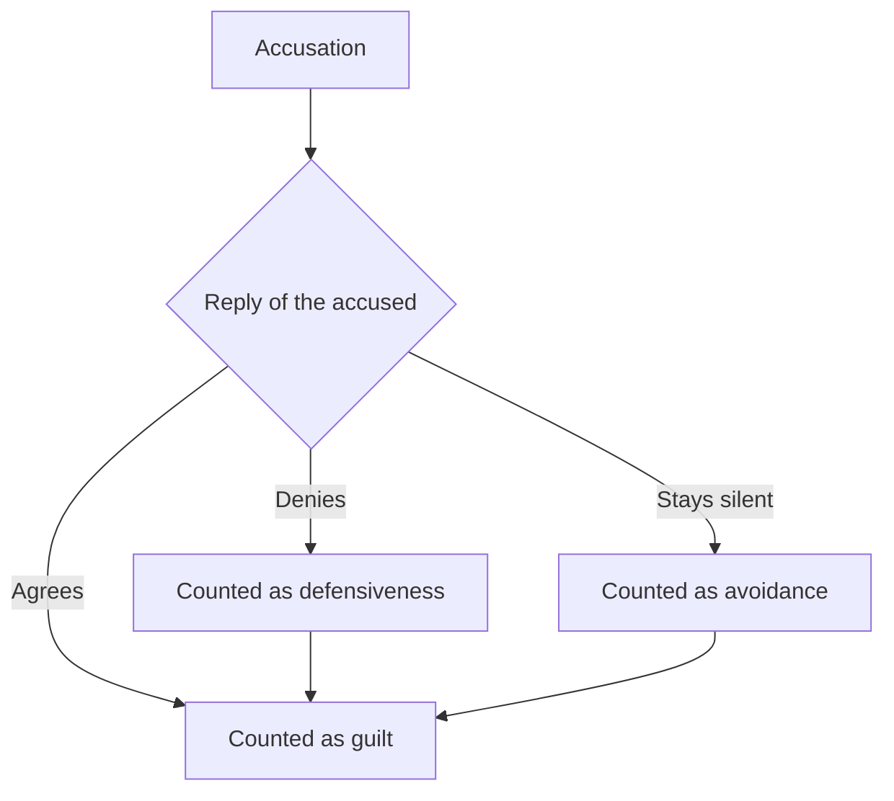

# Kafka trap

## Summary

A Kafka trap, or kafkatrap, is an argument in which denying an accusation is counted as proof of it. The name was coined by Eric S. Raymond in 2010 and refers to Franz Kafka's novel *The Trial*. It is a label for a logical structure, not a psychological trait. Its psychology is the psychology of unfalsifiable beliefs: confirmation bias, motivated reasoning and defensiveness. The same pattern appears in witch tests, in some readings of psychoanalytic "denial" and in everyday arguments.

*This note is educational. It describes an argument form and does not take a side in any political or personal dispute.*

## Prerequisites

- [Heuristics and biases](../../cognitive-psychology/heuristics-and-biases.md) for the idea that judgment follows predictable shortcuts.

## Core concepts

### Definition

A *Kafka trap* is an accusation built so that every possible reply confirms it. If the accused agrees, the accusation is true. If the accused denies it, the denial is read as evidence of guilt, defensiveness or blindness, so the accusation is again true. In logical terms the accusation is *unfalsifiable*: no observation could count against it. Evidence that fits all outcomes tells us nothing about which is true.

### Origin

Franz Kafka's *The Trial* (written 1914 to 1915, published 1925) follows Josef K., who is arrested and tried for an offense that is never named, in a process that gives him no way to clear himself. Raymond (2010) used the novel's image on 18 July 2010 in a blog post named "Kafkatrapping". He described the "Model A" trap as the claim that refusing to acknowledge guilt confirms the guilt, and argued that the form is manipulative whatever the accusation. His examples were drawn from debates about prejudice, and the term has since been used from several political directions. The form itself is older than the name. Tests for witchcraft, in which a suspect who floated and a suspect who sank were both found guilty or doomed, had the same logic. Popper (1963) criticized psychoanalytic and Marxist theories of his time for explaining every possible observation, which made them irrefutable and, in his view, unscientific.

### Analogy

A Kafka trap is a coin that is described as "heads, I win" and also as "tails, you lose". The analogy shows why the form is unfair. It breaks because real accusations are often partly true, and a coin has no truth to find.

### Psychological aspects

**Confirmation bias.** People look for and interpret information so that it supports what they already believe (Nickerson, 1998). Once a person is sure of guilt, any reply is read as support. The trap is what confirmation bias looks like when it has been turned into a rule.

**Motivated reasoning and belief protection.** An unfalsifiable framework protects a belief from loss. The believer does not need to feel they are lying. They may sincerely think the denial is a symptom.

**Defensiveness is ambiguous evidence.** Defensive reactions are common among the innocent and the guilty, so on its own defensiveness does not discriminate between them. This is the key quantitative point, shown below.

**The accused's side.** Being trapped can lead to withdrawal, to over-apologizing or to anger. An outsider who sees the anger may read it as confirmation, which closes the loop.



The diagram shows the defining property: three different replies lead to one verdict.

### Evidence status

The structure is logical, not empirical, and so is not in dispute. Whether any specific real case is a Kafka trap is a matter of argument and needs facts about that case. Resisting an accusation is not in itself a trap, and a claim that is supported by independent evidence is not one either.

## Worked example

Take a prior probability of guilt of 0.5. A real test has a 0.8 chance of a positive result when someone is guilty and 0.2 when someone is innocent. Under a Kafka trap, the denial is read as a sign of guilt whether the accused is guilty or innocent, so the chances are 1.0 and 1.0.

```python
# Python 3.12. Evidence that fits both hypotheses has a likelihood ratio of 1.
def update(prior, p_if_guilty, p_if_innocent):
    num = p_if_guilty * prior
    return num / (num + p_if_innocent * (1 - prior))

prior = 0.5
print("informative test (0.8 vs 0.2):", round(update(prior, 0.8, 0.2), 3))
print("kafkatrap reading (1.0 vs 1.0):", round(update(prior, 1.0, 1.0), 3))
```

Output:

```text
informative test (0.8 vs 0.2): 0.8
kafkatrap reading (1.0 vs 1.0): 0.5
```

The informative test moves belief from 0.5 to 0.8. The trap leaves it at 0.5. Feeling more certain without any evidence that discriminates is the error. The values are an example.

How to respond when the form appears: ask what observation would count against the claim. If the answer is "none", the claim is not testable and should carry no weight in a decision. If there is an answer, discuss that evidence.

## Trade offs and when to use it

The label is a good tool for spotting a bad argument. It becomes a bad argument itself when it is used as a general reply that ends discussion ("that is a Kafka trap") without showing that the claim is unfalsifiable. Calling any reasoned challenge a trap is a form of the same fault. Use the label for the form of the argument, not for the person using it.

## Common mistakes

- **Calling every accusation a trap.** A claim is a trap only if no reply could count against it.
- **Treating the denial as irrelevant.** A plausible denial with evidence is still informative.
- **Mixing up the logic with the topic.** The form is wrong whoever uses it and about whatever subject.
- **Confusing it with psychological denial.** Denial in clinical use is a defense mechanism, and the claim that someone is in denial is itself testable only if criteria exist.

## Practice

1. Who coined the term, and which novel does it refer to?
2. Why does a likelihood ratio of 1 mean the evidence is useless?
3. What question helps test whether a claim is unfalsifiable?

### Answers

1. Eric S. Raymond, in 2010, referring to Kafka's *The Trial*.
2. The evidence is equally likely under both hypotheses, so it cannot change the belief.
3. What observation would count against the claim?

## Further reading

- Raymond, E. S. (2010). Kafkatrapping. Armed and Dangerous (blog), 18 July 2010. [Link](https://web.archive.org/web/2012/http://esr.ibiblio.org/?p=2122). The post that named the argument form and defined its first model.
- Kafka, F. (1925). *The Trial*. Many editions. The novel in which Josef K. is accused of an unnamed offense and cannot get a clear answer from the process.
- Popper, K. R. (1963). *Conjectures and Refutations*. Routledge. Argues that a theory that no observation could contradict is not scientific, and uses psychoanalysis as an example.
- Nickerson, R. S. (1998). Confirmation Bias: A Ubiquitous Phenomenon in Many Guises. *Review of General Psychology*, 2(2), 175-220. [DOI](https://doi.org/10.1037/1089-2680.2.2.175). A broad review of confirmation bias and of how it protects beliefs from disconfirming evidence.
