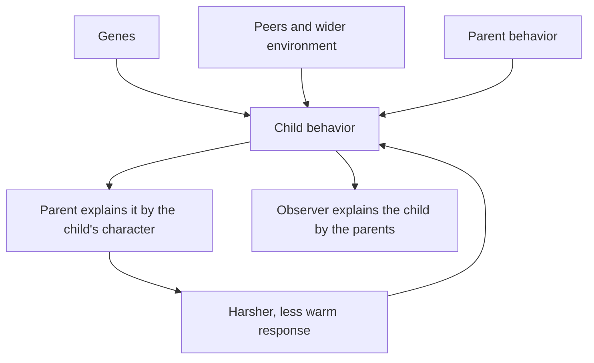
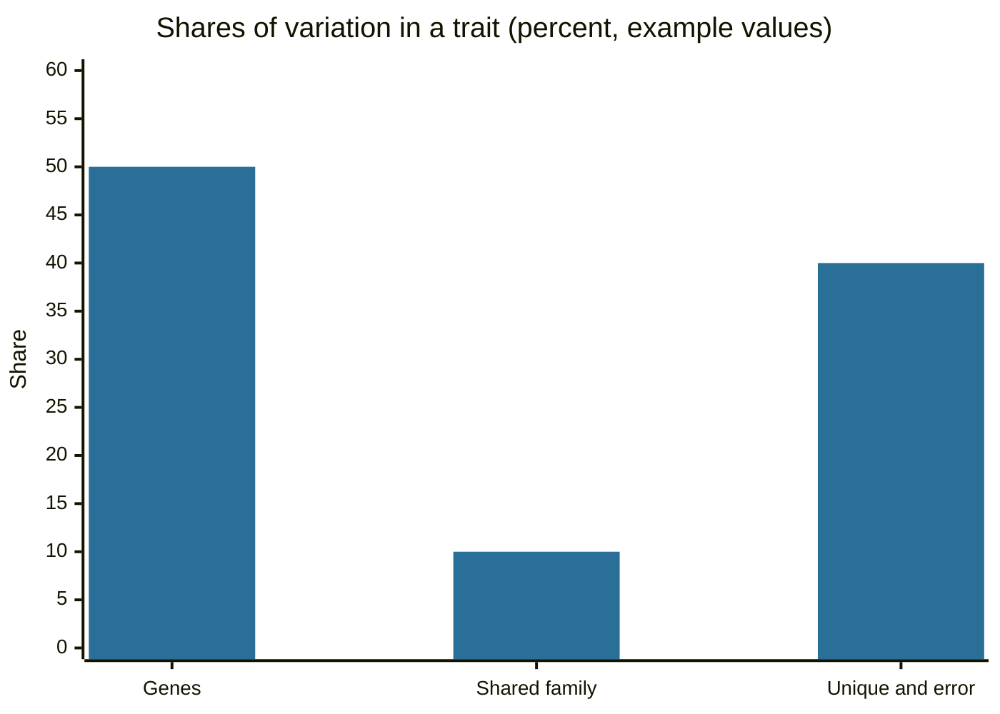

# Parental attribution error

## Summary

"Parental attribution error" is not a standard term. It is used for two different mistakes about the link between parents and children. In the first, parents explain a child's behavior by the child's character ("he is lazy", "she does it to spite me"). Research on parental attributions shows that this matters for how parents act. In the second, observers explain a child's character by the parents' behavior and ignore genes, peers and the child's own influence. Twin studies and work on child effects show that this second view is too simple.

*This note is educational. It is not parenting or clinical advice, and it does not suggest that parents are not responsible for how they treat their children.*

## Prerequisites

- [Attribution biases](../../social-psychology/attribution-biases.md) for the fundamental attribution error.

## Core concepts

### Definition

An *attribution* is a causal explanation of behavior. The *fundamental attribution error* is the tendency to explain another person's behavior by their traits and to underrate the situation. The label *parental attribution error* is applied here to two cases: **parent-to-child**, where a parent explains a child's behavior by the child's disposition, and **observer-to-parent**, where an observer explains a child's outcome by the parent's behavior alone. Neither has a single agreed definition.

### Origin

The label appears in popular writing as a mother's or father's version of the fundamental attribution error. The research it points to has two older roots. One is work on social cognition in aggression: Dodge (1980) found that aggressive boys attribute hostile intent to ambiguous acts, and the same biased reading was later studied in parents. The other is the debate on socialization: Bell (1968) argued that the direction of influence runs from child to parent as well as from parent to child, and Harris (1995, 1998) argued that parents matter less for lasting personality than the common assumption holds. A historical case of the second error is the claim of Bettelheim (1967) that cold "refrigerator mothers" cause autism, which research has since refuted.

### Analogy

A coach blames the quarterback alone for a lost game, and the quarterback blames lazy receivers for every dropped pass. In both cases the cause is placed in a person and the situation is left out. The analogy breaks because a family is a long relationship in which the explanation itself changes the behavior.

### Psychological aspects

**Parent-to-child attributions shape parenting.** Bugental and Johnston (2000) review how parents' beliefs about their children's behavior affect how they treat them. When parents see misbehavior as stable, intentional and aimed at them, they tend to respond with more harshness and less warmth. Milner (2003) describes a social information processing model in which parents at high risk of physical abuse more often read child behavior as hostile and deliberate. These are associations, and the causal direction is shared: difficult behavior also causes the attribution.

**Child effects.** Bell (1968) showed that child behavior shapes parent behavior. A child with a difficult temperament draws stricter control, so the parental style in a study can be partly a result of the child.

**Genes and the shared environment.** Twin studies split resemblance into genetic, shared environment and unique environment. Polderman et al. (2015), in a meta-analysis of 50 years of twin research, estimated an average heritability of about 49% across human traits. For many traits the shared family environment contributes little to differences in adulthood. This does not mean that parenting has no effect. Extreme neglect and abuse have large effects, and parenting affects the experience of childhood and the relationship itself.

**Why the error is attractive.** People like simple causal stories, parents are visible and responsible, and the genetic share is invisible. The *fundamental attribution error* and the *just-world* tendency to find a cause for outcomes both push in this direction.

### Evidence status

Parental attributions as predictors of parenting are well studied. The popular label itself is not a research construct. Heritability estimates are population averages. They do not say how much of one person's traits comes from genes.



The diagram shows the first error as a loop between child and parent, and the second as an explanation that leaves out genes and peers.

## Worked example

Twin correlations let one split resemblance into parts. With identical twins correlating 0.60 and fraternal twins 0.35 on a trait (example values), Falconer's formulas give the shares.

```python
# Python 3.12. Falconer's formulas from twin correlations (example correlations).
r_mz, r_dz = 0.60, 0.35
h2 = 2 * (r_mz - r_dz)    # additive genetic share
c2 = 2 * r_dz - r_mz      # shared family environment
e2 = 1 - r_mz             # unique environment and error
print(round(h2, 2), round(c2, 2), round(e2, 2))
```

Output:

```text
0.5 0.1 0.4
```

Half of the differences in this made-up trait come from genes, 10% from the shared family environment and 40% from unique experiences and error. An observer who credits the parents for the whole outcome would miss at least half. Note that the formulas are a simplification and the shares describe a population, not an individual child.



## Trade offs and when to use it

The concept is useful as a prompt to ask for another explanation: does the child have a reason, a skill gap or a temperament that I read as a character flaw? Parents who replace "he is doing this on purpose" with "he cannot do it yet" tend to respond with more patience, which fits the research on attributions. The second error is a warning against both blame and credit: parents should not be assumed to be the sole cause of how a child turns out, and they are still responsible for how they treat the child.

## Common mistakes

- **Reading a behavior as hostile intent.** Young children often lack the skill, not the will.
- **Assuming parents explain everything.** Genes, peers and chance also matter.
- **Concluding that parenting does not matter.** Heritability is an average over a population and says nothing against the effects of abuse, neglect and warmth.
- **Using the label as an accusation.** It describes a type of reasoning, not a defect in a parent.

## Practice

1. Describe the two meanings of "parental attribution error" in this note.
2. What did Bell (1968) argue about the direction of influence?
3. With twin correlations of 0.60 (identical) and 0.35 (fraternal), what share does Falconer's formula assign to genes?

### Answers

1. Parents explaining a child's behavior by the child's character, and observers explaining a child's outcome by the parents alone.
2. That influence runs from child to parent as well as from parent to child.
3. 2 x (0.60 - 0.35) = 0.50, or 50%.

## Further reading

- Bugental, D. B. and Johnston, C. (2000). Parental and Child Cognitions in the Context of the Family. *Annual Review of Psychology*, 51(1), 315-344. [DOI](https://doi.org/10.1146/annurev.psych.51.1.315). Reviews how parents' beliefs about their children shape parenting and child outcomes.
- Milner, J. S. (2003). Social information processing in high-risk and physically abusive parents. *Child Abuse & Neglect*, 27(1), 7-20. [DOI](https://doi.org/10.1016/S0145-2134(02)00506-9). Describes how abusive parents process information about child behavior, including hostile attributions.
- Dodge, K. A. (1980). Social Cognition and Children's Aggressive Behavior. *Child Development*, 51(1), 162-170. [DOI](https://doi.org/10.2307/1129603). Shows that aggressive boys attribute hostile intent to ambiguous acts.
- Bell, R. Q. (1968). A reinterpretation of the direction of effects in studies of socialization. *Psychological Review*, 75(2), 81-95. [DOI](https://doi.org/10.1037/h0025583). Argues that children influence parents as well as the reverse.
- Harris, J. R. (1995). Where is the child's environment? A group socialization theory of development. *Psychological Review*, 102(3), 458-489. [DOI](https://doi.org/10.1037/0033-295X.102.3.458). Argues that peers may matter more than parents for development outside the home.
- Harris, J. R. (1998). *The Nurture Assumption*. Free Press. A popular statement of the argument that parents have less lasting influence on personality than assumed.
- Polderman, T. J. C., Benyamin, B., de Leeuw, C. A. et al. (2015). Meta-analysis of the heritability of human traits based on fifty years of twin studies. *Nature Genetics*, 47(7), 702-709. [DOI](https://doi.org/10.1038/ng.3285). A meta-analysis of 50 years of twin studies that estimates average heritability of human traits at about 49 percent.
- Bettelheim, B. (1967). *The Empty Fortress: Infantile Autism and the Birth of the Self*. Free Press. Source of the since refuted claim that cold parenting causes autism.
