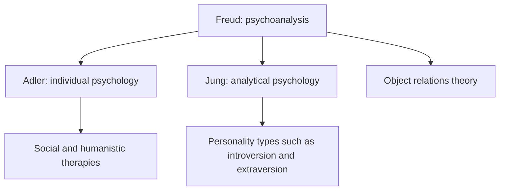

# Psychodynamic schools: Freud, Adler and Jung

## Summary

Psychodynamic psychology began with Sigmund Freud's psychoanalysis, and two early colleagues, Alfred Adler and Carl Jung, broke from him to found their own schools. Freud stressed unconscious drives and conflict, Adler stressed striving for superiority and social interest in individual psychology, and Jung added the collective unconscious and personality types. Their ideas shaped psychotherapy and culture. Many specific claims are hard to test, and modern psychodynamic therapy is a different, more empirical practice.

*This note is educational. It is not clinical advice.*

## Prerequisites

- [Object relations theory](object-relations-theory.md) for a later development of the tradition.

## Core concepts

### Definition

*Psychodynamic* theories explain behavior by interacting forces in the mind, many of them outside awareness, with roots in early experience. Ellenberger (1970) gives the history of how the three schools arose from the study of hysteria and hypnosis in the 19th century.

### The three schools

| School | Founder | Core ideas | Technique |
| --- | --- | --- | --- |
| Psychoanalysis | Sigmund Freud | Unconscious drives, defense mechanisms, psychosexual development, id, ego and superego | Free association, interpretation of dreams and transference |
| Individual psychology | Alfred Adler | Striving to overcome inferiority, social interest, lifestyle (a person's characteristic way of living), birth order as a possible influence | Encouragement and examination of the lifestyle |
| Analytical psychology | Carl Jung | Personal and collective unconscious, archetypes, persona and shadow, introversion and extraversion | Dream and symbol work, active imagination |

### Analogy

The mind is like an iceberg in Freud's well-known image, with most of it below the water. Adler would say that the iceberg is steered by the person's goals, and Jung would add that deep below lies a layer shared by all ice. The limit of the analogy is that these are pictures, and not measurements.

### Relations

### Evidence

- Many core claims, such as the psychosexual stages and archetypes, cannot be tested well, and the evidence for them is weak.
- Jung's introversion and extraversion survive as a personality dimension, though the type instruments built on his theory, such as the Myers-Briggs, have weaker reliability than trait measures.
- Modern psychodynamic therapy has been tested in trials. Shedler (2010) reviewed meta-analyses and concluded that it is effective, and some of its benefit continues after treatment ends. Later commentary debates the size of the effect and the quality of the studies.

## Worked example

A client reports that every time they are praised, they feel anxious and change the subject. The three schools would give different readings.

| School | Possible reading |
| --- | --- |
| Freud | An unconscious conflict, with praise reviving an old fear of punishment |
| Adler | Feeling of inferiority: praise does not fit the self-image and has to be deflected |
| Jung | A persona that does not match the self, with praise exposing the gap |

The readings are not tested against each other in the example. They show how the schools give different questions to ask, which a therapist may use as hypotheses.

## Trade offs and when to use it

The schools are important for history and for understanding the language of therapy and culture. For treatment decisions, the evidence for specific methods matters more than the school. Pop-cultural uses, such as personality quizzes based on Jung, tend to claim more than the theory supports.

## Common mistakes

- **Treating the theories as proven science.** Many claims are untestable.
- **Confusing Jung's types with validated trait measures.** The evidence is weaker.
- **Equating modern psychodynamic therapy with 19th-century psychoanalysis.** The practice has changed.

## Practice

1. What is the central idea of Adler's individual psychology?
2. What did Jung add to Freud's concept of the unconscious?
3. Why is the evidence for psychodynamic ideas mixed?

### Answers

1. Striving to overcome inferiority, together with social interest.
2. The collective unconscious, with archetypes shared across people.
3. Many claims are hard to test, while some therapy outcomes have been tested and show benefits.

## Further reading

- Ellenberger, H. F. (1970). *The Discovery of the Unconscious*. Basic Books. A history of dynamic psychiatry covering Freud, Adler and Jung.
- Shedler, J. (2010). The efficacy of psychodynamic psychotherapy. *American Psychologist*, 65(2), 98-109. [DOI](https://doi.org/10.1037/a0018378). Reviews meta-analyses of psychodynamic therapy outcomes.
