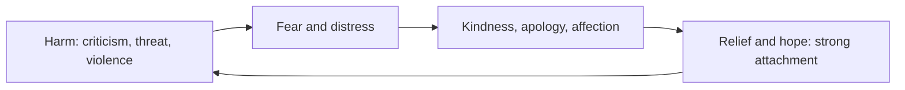

# Trauma bonding

## Summary

Trauma bonding describes a strong emotional attachment between a person and someone who abuses them, built by cycles of harm and kindness. The term comes from research on abusive relationships, where Dutton and Painter described traumatic bonding. A power imbalance and intermittent reward are the two features that maintain the bond. It is not a formal diagnosis, and it helps to explain why leaving an abusive relationship is hard.

*This note is educational. If you are in danger, contact local emergency services or a domestic violence helpline.*

## Prerequisites

- [Predictors of relationship quality](../close-relationships/relationship-quality.md).

## Core concepts

### Definition

Dutton and Painter (1993) proposed *traumatic bonding* to explain why abused people stay emotionally attached. They said that two conditions give rise to it: a power imbalance, in which one person dominates, and intermittent abuse alternating with good treatment. In a test with women who had experienced abuse, the strength of attachment was related to the imbalance of power and to the intermittence of the abuse.

### Analogy

Intermittent reward is the logic of a slot machine: because the reward comes unpredictably, behavior persists. The limit of the analogy is that in an abusive relationship the stakes are a person's safety, and the bond also involves fear, dependence and hope.

### Mechanism

### What it is not

| Concept | Difference |
| --- | --- |
| Healthy attachment | Safe and responsive, without cycles of harm |
| Stockholm syndrome | A related label from hostage situations, with limited empirical basis |
| Codependency | A broader popular term with different meanings |

## Worked example

A person describes a partner who criticizes them harshly for weeks and then, after an argument, is affectionate and promises to change. The person says: "He is not like that all the time." The cycle follows the model: harm, relief and hope. A supportive response does not argue about the partner's character. It helps the person to see the pattern, to keep a record of events, to build contact with trusted people, and to make a safety plan with a specialized service.

## Trade offs and when to use it

The concept helps friends, clinicians and the person involved understand why staying does not mean agreeing with the abuse. It is a descriptive term, and not every difficult relationship is a trauma bond. The risk of leaving is greatest after separation, so safety planning with professionals is important.

## Common mistakes

- **Blaming the person for staying.** The bond is a predictable result of the pattern.
- **Calling every conflict a trauma bond.** The pattern needs real harm and intermittent kindness.
- **Giving advice to simply leave.** Leaving needs planning and support.

## Practice

1. Which two conditions did Dutton and Painter (1993) name?
2. Why does intermittent kindness strengthen the bond?
3. Why is a safety plan important?

### Answers

1. A power imbalance and an intermittent pattern of abuse and good treatment.
2. Unpredictable relief and hope make the attachment stronger, like intermittent reward.
3. The period around leaving can carry the highest risk, and professionals can help to reduce it.

## Further reading

- Dutton, D. G. and Painter, S. (1993). Emotional Attachments in Abusive Relationships: A Test of Traumatic Bonding Theory. *Violence and Victims*, 8(2), 105-120. [DOI](https://doi.org/10.1891/0886-6708.8.2.105). The research that described traumatic bonding in abusive relationships.
