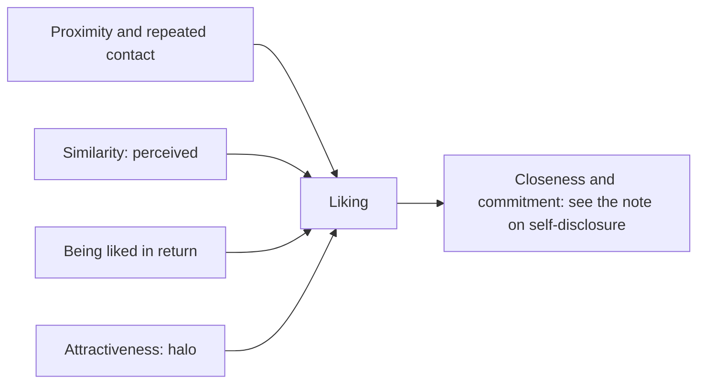

# Attraction and dating

## Summary

Research on attraction finds a small set of reliable factors: proximity and repeated contact, similarity, liking in return and physical attractiveness. The folk belief that opposites attract is not supported. Studies of speed dating show that people's stated preferences for a partner predict little about whom they actually like on meeting. Many tactics from the dating advice literature, such as playing hard to get, have not been tested in a rigorous way, and honest, warm interaction is the best supported approach.

*This note is educational. It is not dating advice.*

## Prerequisites

- [Mere exposure effect](../cognitive-psychology/mere-exposure-effect.md).
- [Liking gap and pratfall effect](../social-psychology/liking-gap-and-pratfall-effect.md).

## Core concepts

### Definition

*Interpersonal attraction* is the force that draws one person to another. Researchers study the early stage (liking) and the later stage (love and commitment) separately.

| Factor | Finding |
| --- | --- |
| Proximity and familiarity | People like those they meet often, partly through mere exposure |
| Similarity | In a meta-analysis, Montoya and colleagues (2008) found that actual similarity predicted attraction in non-interactive settings, and that perceived similarity predicted it in real interaction |
| Reciprocal liking | People like those who like them, and underestimate that liking (liking gap) |
| Physical attractiveness | Attractive people are assumed to have better personalities, the halo effect (Dion, Berscheid and Walster, 1972) |
| Warmth and responsiveness | Perceived responsiveness is associated with intimacy |

### Stated and actual preferences

In a speed-dating study, Eastwick and Finkel (2008) found that the sex differences in the stated importance of attractiveness and earning potential were not reflected in whom participants liked after meeting. Stated preferences before meeting did not predict the attraction felt on meeting. Hyde (2005) reviewed meta-analyses and found that most psychological gender differences are small.

### Analogy

Choosing a partner by a checklist of preferences is like choosing a restaurant by its menu in advance: it narrows the field, and the meal decides. The limit of the analogy is that, unlike a restaurant, the other person also responds to you.

### Arousal and novelty

In a well-known field study, Dutton and Aron (1974) found that men approached on a high suspension bridge reported more attraction to an interviewer than men on a low bridge. The interpretation was that arousal from fear was misattributed to attraction, and replication evidence is mixed. A more robust result: couples who share novel, arousing activities report higher relationship quality (Aron et al., 2000). This supports varied shared activities, and not manufactured fear.

## Worked example

Two people meet at an event and talk for ten minutes. A rough check against the research:

| Factor | What helps |
| --- | --- |
| Proximity | Meet again in a shared setting, such as a class or a team |
| Similarity | Find actual shared interests and values by asking, and do not pretend |
| Reciprocal liking | Show interest, and remember the liking gap: the other person likely liked the talk |
| Novelty | Choose a new activity for the second meeting instead of the usual one |

Techniques such as feigned indifference are not backed by good evidence, and risk coming across as uninterested.

## Trade offs and when to use it

The findings give a practical, honest approach: create chances for repeated contact, be warm, ask questions and try shared new activities. Finkel and colleagues (2012) reviewed online dating and concluded that it widens access to potential partners, while the claims of matching algorithms are not supported by published evidence. Attraction is not the same as a good relationship: the predictors of long-term quality are different (see the note on predictors of relationship quality).

## Common mistakes

- **Believing opposites attract.** Similarity has the better support.
- **Trusting a stated checklist.** It predicts attraction on meeting poorly.
- **Using manipulative tactics.** They are untested and damage trust.
- **Confusing attraction with compatibility.** They predict different things.

## Practice

1. What did Montoya and colleagues (2008) find about similarity?
2. What did the speed-dating study of Eastwick and Finkel (2008) show?
3. What is a better supported alternative to the suspension bridge effect?

### Answers

1. Actual similarity predicted attraction in non-interactive settings, and perceived similarity predicted it in real interaction.
2. Stated preferences before meeting did not predict attraction after meeting, and the stated sex differences did not appear in actual choices.
3. Shared novel and arousing activities, which are linked to higher relationship quality.

## Further reading

- Montoya, R. M., Horton, R. S. and Kirchner, J. (2008). Is actual similarity necessary for attraction? A meta-analysis of actual and perceived similarity. *Journal of Social and Personal Relationships*, 25(6), 889-922. [DOI](https://doi.org/10.1177/0265407508096700). A meta-analysis of similarity and attraction.
- Eastwick, P. W. and Finkel, E. J. (2008). Sex differences in mate preferences revisited: Do people know what they initially desire in a romantic partner?. *Journal of Personality and Social Psychology*, 94(2), 245-264. [DOI](https://doi.org/10.1037/0022-3514.94.2.245). A speed-dating study of stated and actual mate preferences.
- Hyde, J. S. (2005). The gender similarities hypothesis. *American Psychologist*, 60(6), 581-592. [DOI](https://doi.org/10.1037/0003-066X.60.6.581). Reviews meta-analyses that find that most psychological gender differences are small.
- Dion, K., Berscheid, E. and Walster, E. (1972). What is beautiful is good. *Journal of Personality and Social Psychology*, 24(3), 285-290. [DOI](https://doi.org/10.1037/h0033731). Shows that attractive people are assumed to have better personalities.
- Dutton, D. G. and Aron, A. P. (1974). Some evidence for heightened sexual attraction under conditions of high anxiety. *Journal of Personality and Social Psychology*, 30(4), 510-517. [DOI](https://doi.org/10.1037/h0037031). The suspension bridge study of arousal and attraction.
- Aron, A., Norman, C. C., Aron, E. N. et al. (2000). Couples' shared participation in novel and arousing activities and experienced relationship quality. *Journal of Personality and Social Psychology*, 78(2), 273-284. [DOI](https://doi.org/10.1037/0022-3514.78.2.273). Shows that shared novel activities raise relationship quality.
- Finkel, E. J., Eastwick, P. W., Karney, B. R. et al. (2012). Online Dating. *Psychological Science in the Public Interest*, 13(1), 3-66. [DOI](https://doi.org/10.1177/1529100612436522). A review of online dating and what science can say about it.
