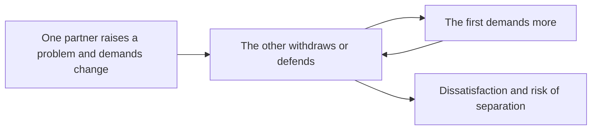

# Predictors of relationship quality

## Summary

Large studies of couples find that satisfaction is predicted best by features of the relationship itself: how committed and appreciated partners feel, how satisfied they are sexually, how satisfied they believe the partner is, and how much they fight. Traits of the individuals matter much less. Observational research on conflict shows that negative patterns, such as a demanding partner meeting a withdrawing partner, predict dissatisfaction and separation. Popular models with acronyms are common in counseling but have little empirical support.

*This note is educational. It is not relationship or therapy advice.*

## Prerequisites

No prior notes are needed.

## Core concepts

### Definition

*Relationship quality* is how satisfied people are with a romantic relationship, and how stable it is. Joel and colleagues (2020) analyzed data from 43 longitudinal studies of couples, using a machine learning approach, and found that the strongest predictors of satisfaction were relationship-specific self-reports. They named five: perceived partner commitment, appreciation, sexual satisfaction, perceived partner satisfaction and conflict. Individual differences, such as personality, predicted less.

### Analogy

A relationship is like a garden that is kept by the actions of two gardeners. The weather and the soil (personality, history) matter, and the daily work (attention, appreciation, handling conflict) matters more. The limit of the analogy is that two gardeners can change each other's habits.

### Patterns in conflict

Christensen and Heavey (1990) described the demand-withdraw pattern, in which one partner pursues discussion and the other avoids it. The roles depend on who wants the change: the partner who wants change tends to demand. Gottman and Levenson (1992) observed couples and found that conflict behavior, including negative affect, predicted later dissolution.

### Popular models

Acronyms such as C.H.A.I.R.S. and C.O.U.P.L.E. (Eggerichs, 2004) list needs that are said to belong to husbands and wives. They are widely used in religious marriage counseling. No strong evidence shows that the lists are accurate or that following them improves relationships, and they rest on a fixed picture of gender roles, while research on psychological gender differences generally finds small ones (Hyde, 2005).

## Worked example

A couple argues about housework, and the discussion follows the demand-withdraw pattern.

| Step | Behavior | Helpful alternative |
| --- | --- | --- |
| 1 | A criticizes: "You never help" | State a specific request: "Can you take the kitchen on Tuesdays?" |
| 2 | B leaves the room | Say "I need ten minutes, and I will come back" |
| 3 | A feels ignored and escalates | Return at the agreed time |
| 4 | Both feel unappreciated | Name one thing the other did well that week |

The alternatives target the predictors: appreciation, conflict and perceived commitment. The example is an illustration, and a couple in a serious conflict can use a qualified counselor.

## Trade offs and when to use it

Use the findings as a checklist of questions about a relationship, and not as a guarantee. Correlations from self-report do not show causes: satisfaction may also raise appreciation. The data come mostly from Western couples. If a relationship involves fear or abuse, the advice about communication does not apply, and safety comes first.

## Common mistakes

- **Treating personality as destiny.** Relationship-specific factors predict more.
- **Believing that no conflict is the goal.** The pattern of conflict matters more than its frequency.
- **Using gender stereotypes as a guide.** The differences between individuals are larger.

## Practice

1. Name the five strongest predictors found by Joel and colleagues (2020).
2. Describe the demand-withdraw pattern.
3. Why is the evidence for the C.H.A.I.R.S. and C.O.U.P.L.E. models weak?

### Answers

1. Perceived partner commitment, appreciation, sexual satisfaction, perceived partner satisfaction and conflict.
2. One partner pursues discussion and change, and the other withdraws, which prompts more pursuit.
3. They have not been tested, they are based on fixed gender roles, and psychological gender differences are generally small.

## Further reading

- Joel, S., Eastwick, P. W., Allison, C. J. et al. (2020). Machine learning uncovers the most robust self-report predictors of relationship quality across 43 longitudinal couples studies. *Proceedings of the National Academy of Sciences*, 117(32), 19061-19071. [DOI](https://doi.org/10.1073/pnas.1917036117). A machine learning study of predictors of relationship quality across 43 couples studies.
- Christensen, A. and Heavey, C. L. (1990). Gender and social structure in the demand/withdraw pattern of marital conflict. *Journal of Personality and Social Psychology*, 59(1), 73-81. [DOI](https://doi.org/10.1037/0022-3514.59.1.73). Studies the demand-withdraw pattern in couples.
- Gottman, J. M. and Levenson, R. W. (1992). Marital processes predictive of later dissolution: Behavior, physiology, and health. *Journal of Personality and Social Psychology*, 63(2), 221-233. [DOI](https://doi.org/10.1037/0022-3514.63.2.221). Links couples' conflict behavior to marital satisfaction and stability.
- Hyde, J. S. (2005). The gender similarities hypothesis. *American Psychologist*, 60(6), 581-592. [DOI](https://doi.org/10.1037/0003-066X.60.6.581). Reviews meta-analyses that find that most psychological gender differences are small.
- Eggerichs, E. (2004). *Love and Respect*. Thomas Nelson. The source of the C.H.A.I.R.S. and C.O.U.P.L.E. acronyms, a popular marital counseling model.
