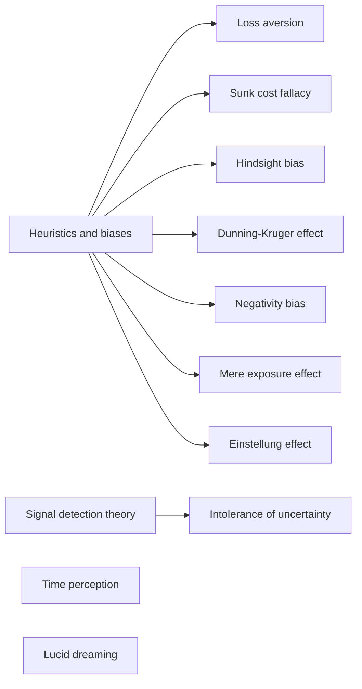

# Cognitive psychology

How people perceive, remember, judge and decide. This subfield belongs to [Psychology](../README.md). It collects the heuristics and biases that shape judgment, the theory of detection under uncertainty and a few topics on the experience of time and dreaming. Notes mark the strength of the evidence, because several popular effects are contested.

## Map of the subfield

The map groups the notes by what they explain.

## Notes in reading order

1. [Heuristics and cognitive biases](heuristics-and-biases.md): shortcuts, systematic errors and how to reduce them.
2. [Loss aversion](loss-aversion.md): why losses weigh more than gains.
3. [Sunk cost fallacy](sunk-cost-fallacy.md): letting spent costs steer future choices.
4. [Hindsight bias](hindsight-bias.md): the feeling of having known it all along.
5. [Dunning-Kruger effect](dunning-kruger-effect.md): self-assessment of skill and a statistical objection.
6. [Negativity bias](negativity-bias.md): why bad weighs more than good.
7. [Mere exposure effect](mere-exposure-effect.md): familiarity and liking.
8. [Einstellung effect](einstellung-effect.md): a familiar solution that hides a better one.
9. [Signal detection theory](signal-detection-theory.md): sensitivity and criterion in yes/no decisions.
10. [Intolerance of uncertainty](intolerance-of-uncertainty.md): risk, ambiguity and the cycle of worry.
11. [Time perception](time-perception.md): how the sense of duration is built and bent.
12. [Lucid dreaming](lucid-dreaming.md): dream awareness, verification and induction.

## Planned topics

- Attention and perception
- Working memory and long-term memory
- Language and thought
