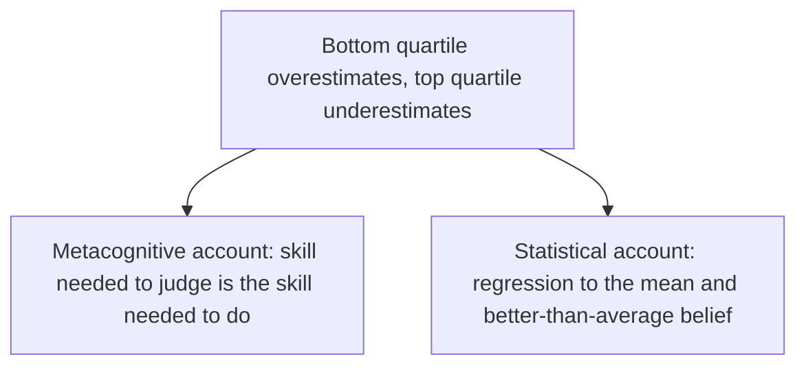

# Dunning-Kruger effect

## Summary

The Dunning-Kruger effect is the finding that people with low skill in a domain tend to overestimate their performance, while people with high skill tend to underestimate theirs a little. The original explanation was a double burden: the skills needed to do a task are the same skills needed to judge it. Later work shows that much of the pattern can arise from statistics and from a general tendency to rate oneself as above average, so the claim that "incompetent people do not know they are incompetent" is too strong.

*This note is educational.*

## Prerequisites

- [Heuristics and cognitive biases](heuristics-and-biases.md).

## Core concepts

### Definition

In a set of studies, Kruger and Dunning (1999) tested people on humor, grammar and logic, and asked them to estimate their own percentile. Those in the bottom quartile estimated themselves well above their actual rank, and those in the top quartile estimated themselves a little below. The popular graph shows self-assessment rising slowly while actual skill rises steeply.

### Analogy

Judging a chess game needs the knowledge of chess that playing needs. A beginner cannot see the move that a strong player sees, so the beginner has no way to know that the move was available. The limit of the analogy is that many beginners are cautious and know that they are beginners, so the effect is an average and not a rule for each person.

### Competing explanations



Gignac and Zajenkowski (2020) argue that the pattern is mostly a statistical artifact: when self-estimates are only loosely related to actual skill, the lowest group must overestimate and the highest group must underestimate, whatever the metacognitive ability. They also report that an analysis that does not have this artifact finds little support for the metacognitive account in intelligence data.

## Worked example

The simulation gives every person the same weakly informed belief about their rank, and adds noise. Nobody in it lacks insight in a special way.

```python
# Python 3.12. A pattern like Dunning-Kruger from noise and a flattering self-view, with no insight difference.
import random
from statistics import mean

random.seed(3)
N = 10_000
true = [random.uniform(0, 100) for _ in range(N)]          # true skill percentile
# everyone guesses about the same, 60, with a weak link to real skill and random error
guess = [min(100, max(0, 0.2 * t + 0.8 * 60 + random.gauss(0, 10))) for t in true]

for q in range(4):
    lo, hi = q * 25, (q + 1) * 25
    group = [i for i in range(N) if lo <= true[i] < hi]
    print(f"quartile {q + 1}: actual {mean(true[i] for i in group):5.1f}, self-estimate {mean(guess[i] for i in group):5.1f}")
```

Output:

```text
quartile 1: actual  12.7, self-estimate  50.6
quartile 2: actual  37.3, self-estimate  55.3
quartile 3: actual  62.3, self-estimate  60.1
quartile 4: actual  87.6, self-estimate  65.4
```

The bottom quartile overestimates by about 38 points and the top quartile underestimates by about 22 points, the shape of the famous graph, from a simple model. This does not show that no metacognitive effect exists. It shows that the graph alone cannot prove one.

## Trade offs and when to use it

The effect is a reminder to seek external feedback in unfamiliar domains, where one's confidence is a poor guide. Confidence and skill are only weakly related in many tests. Avoid using the label as an insult: it describes an average in a sample.

## Common mistakes

- **Using it to mock a person.** The finding is about group averages.
- **Reading the graph as proof of the double burden.** Statistical artifacts produce the same shape.
- **Believing that experts are always humble.** The top group underestimates only slightly.
- **Equating low skill with overconfidence in every domain.** It depends on the task and the person.

## Practice

1. What did Kruger and Dunning (1999) find about the bottom quartile?
2. Give one statistical explanation of the pattern.
3. What is a practical remedy for miscalibrated self-assessment?

### Answers

1. They rated themselves well above their actual rank.
2. Self-estimates are loosely related to skill, so low performers must overestimate and high performers underestimate (regression to the mean).
3. Seek external, objective feedback and compare with benchmarks.

## Further reading

- Kruger, J. and Dunning, D. (1999). Unskilled and unaware of it: How difficulties in recognizing one's own incompetence lead to inflated self-assessments. *Journal of Personality and Social Psychology*, 77(6), 1121-1134. [DOI](https://doi.org/10.1037/0022-3514.77.6.1121). The original Dunning-Kruger studies of poor performers overestimating their skill.
- Gignac, G. E. and Zajenkowski, M. (2020). The Dunning-Kruger effect is (mostly) a statistical artefact: Valid approaches to testing the hypothesis with individual differences data. *Intelligence*, 80, 101449. [DOI](https://doi.org/10.1016/j.intell.2020.101449). Argues that much of the Dunning-Kruger pattern is a statistical artifact and tests it on intelligence data.
