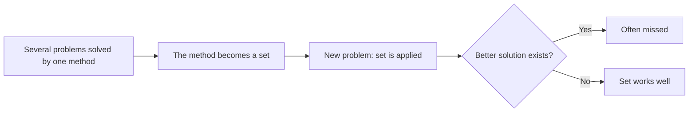

# Einstellung effect

## Summary

The Einstellung effect is the tendency to keep using a familiar solution to a problem, even when a simpler or better one is available. German for "setting" or "attitude", the term comes from Luchins's water jar problems of the 1940s. Eye-movement work with chess players shows that the familiar idea can block the better one even when the person is trying to find it. Experience makes people fast, and the same experience can narrow what they notice.

*This note is educational.*

## Prerequisites

- [Heuristics and cognitive biases](heuristics-and-biases.md).

## Core concepts

### Definition

The *Einstellung effect* is the negative effect of previous experience when a familiar method for a problem prevents finding a better solution. A related term is *functional fixedness*. In Luchins's task, participants measured a target amount of water with three jars of given sizes. After several problems that all required the same long procedure, many used it also on a problem that had a much shorter solution.

### Analogy

A well-worn route on a map is so familiar that a new, shorter road is not noticed on it. The limit of the analogy is that the driver can see the road, while in the Einstellung effect the person looks at the better solution without registering it.

### Evidence

Bilalić, McLeod and Gobet (2008) had chess players solve a problem that had a familiar five-move solution and a shorter three-move one. Players who found the familiar solution said they were looking for a better one, and their eye movements showed that they continued to look at the squares of the familiar solution. The set operated outside of awareness.



## Worked example

Jars A, B and C hold a, b and c units, and the goal is a target amount. Five training problems all work with the long rule B - A - 2C. A sixth problem works with this rule and also with the shorter rule A - C. The problems are built in the style of Luchins (1942) and the sixth one is constructed for this example.

```python
# Python 3.12. Einstellung: a familiar solution rule hides a shorter one (problems built in the style of Luchins, 1942).
problems = [(21, 127, 3, 100), (14, 163, 25, 99), (18, 43, 10, 5), (9, 42, 6, 21), (20, 57, 4, 29)]   # jars A, B, C and the target
critical = (23, 49, 3, 20)

def long_rule(a, b, c, target):      # fill B, pour off A once and C twice
    return b - a - 2 * c == target

def short_rule(a, b, c, target):     # simply A minus C
    return a - c == target

for p in problems:
    print(p, "long rule:", long_rule(*p))
print(critical, "long rule:", long_rule(*critical), "short rule:", short_rule(*critical))
```

Output:

```text
(21, 127, 3, 100) long rule: True
(14, 163, 25, 99) long rule: True
(18, 43, 10, 5) long rule: True
(9, 42, 6, 21) long rule: True
(20, 57, 4, 29) long rule: True
(23, 49, 3, 20) long rule: True short rule: True
```

A solver trained on the first five will often apply the long rule to the sixth problem, three pours against one. A solver who sees the problem fresh finds the short rule. The case shows that both rules are correct, and the effect is about the cost of the longer path.

## Trade offs and when to use it

Habits make experts fast and efficient, and in stable situations the familiar solution is often right. The risk rises when the problem looks like a familiar one but has changed. Remedies: restate the problem in other words, look for a solution before using the known one, ask someone without the experience, and set aside time to question the method.

## Common mistakes

- **Treating experience as always helpful.** It can narrow search.
- **Assuming that effort finds the better solution.** The players in the chess study tried and failed.
- **Believing that only novices are affected.** Experts showed the effect.

## Practice

1. What is the Einstellung effect?
2. What did the eye movements of chess players show?
3. Name one remedy.

### Answers

1. A familiar solution blocks a better one.
2. Players kept looking at squares of the familiar solution while believing they were searching for a better one.
3. Restate the problem, or ask someone with no experience of the method.

## Further reading

- Bilalić, M., McLeod, P. and Gobet, F. (2008). Why good thoughts block better ones: The mechanism of the pernicious Einstellung (set) effect. *Cognition*, 108(3), 652-661. [DOI](https://doi.org/10.1016/j.cognition.2008.05.005). Eye-movement evidence that a familiar solution blocks a better one in chess experts.
- Kahneman, D. (2011). *Thinking, Fast and Slow*. Farrar, Straus and Giroux. A general account of heuristics, biases and the two modes of thinking.
