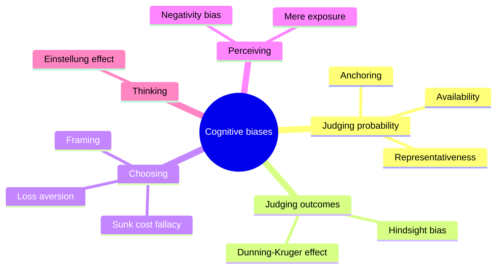

# Heuristics and cognitive biases

## Summary

A heuristic is a fast mental shortcut that usually gives a good answer with little effort. A cognitive bias is a systematic error that a shortcut produces in some situations. The research program of Tversky and Kahneman showed that judgments under uncertainty follow a few shortcuts, such as availability and anchoring, whose errors are predictable. Knowing a bias by name helps spot it, but studies show that awareness alone rarely removes it, and that changing the decision process works better.

*This note is educational. It is not advice for any decision.*

## Prerequisites

No prior notes are needed.

## Core concepts

### Definition

A *heuristic* is a rule of thumb that replaces a hard question by an easier one. A *cognitive bias* is a systematic deviation from a normative standard, such as probability theory, in judgment or choice. Tversky and Kahneman (1974) described three general heuristics:

- **Representativeness:** judging probability by how much something resembles a typical case.
- **Availability:** judging frequency by how easily examples come to mind.
- **Anchoring and adjustment:** starting from a number and adjusting too little.

Kahneman (2011) describes the same ideas with two modes of thinking: a fast, automatic mode and a slow, effortful one.

### Analogy

A heuristic is a path worn across a field. It saves time on most days and leads to the same muddy spot every time it rains. The limit of the analogy is that a path is fixed, while the same shortcut can be accurate in one environment and misleading in another.

### Map of common biases

The map groups the biases that have their own notes in this subfield by the stage of thinking at which they act.

### How to reduce bias

| Approach | Idea | Evidence |
| --- | --- | --- |
| Awareness | Learn the names of biases | Weak: knowing a bias does not remove it |
| Decision process | Use checklists, outside views, base rates and independent estimates | Better supported (Milkman, Chugh and Bazerman, 2009) |
| Expert intuition | Trust intuition only in regular environments with fast, clear feedback | Kahneman and Klein (2009) |
| Choice architecture | Change the environment, for example defaults | Often effective |

## Worked example

A manager must estimate the duration of a project. She first hears the figure "six months" from a colleague, then makes her own estimate of eight months. This is anchoring: her number is pulled toward the first one. A better process is to collect three independent estimates before any is shared, and to compare with the durations of similar past projects (the outside view).

## Trade offs and when to use it

Shortcuts are efficient and often right, and the cost of a full analysis is sometimes higher than the cost of an error. Use deliberate methods when stakes are high, the situation is new or the feedback is slow. Treating every deviation from the normative model as irrational overstates the case: Simon (1955) argued that people with limited time and information do well to satisfice.

## Common mistakes

- **Believing that knowing biases protects against them.** The effects persist.
- **Calling every error a bias.** A bias is a systematic pattern, and random errors are noise.
- **Seeing biases only in others.** The bias blind spot is itself widespread.
- **Treating the list as a complete theory.** Lists of hundreds of biases overlap a great deal.

## Practice

1. Name the three heuristics of Tversky and Kahneman (1974).
2. Why is awareness of a bias a weak remedy?
3. What is the outside view?

### Answers

1. Representativeness, availability, and anchoring and adjustment.
2. The processes act automatically, so the error persists, and process changes work better.
3. Estimating from the outcomes of similar past cases and not from the details of the case at hand.

## Further reading

- Tversky, A. and Kahneman, D. (1974). Judgment under Uncertainty: Heuristics and Biases. *Science*, 185(4157), 1124-1131. [DOI](https://doi.org/10.1126/science.185.4157.1124). The paper that introduced anchoring, representativeness and availability as judgment heuristics.
- Kahneman, D. (2011). *Thinking, Fast and Slow*. Farrar, Straus and Giroux. A general account of heuristics, biases and the two modes of thinking.
- Milkman, K. L., Chugh, D. and Bazerman, M. H. (2009). How Can Decision Making Be Improved?. *Perspectives on Psychological Science*, 4(4), 379-383. [DOI](https://doi.org/10.1111/j.1745-6924.2009.01142.x). Reviews ways of improving decision making.
- Kahneman, D. and Klein, G. (2009). Conditions for intuitive expertise: A failure to disagree. *American Psychologist*, 64(6), 515-526. [DOI](https://doi.org/10.1037/a0016755). Conditions under which intuitive judgment can be trusted.
- Simon, H. A. (1955). A Behavioral Model of Rational Choice. *The Quarterly Journal of Economics*, 69(1), 99. [DOI](https://doi.org/10.2307/1884852). Introduces bounded rationality and satisficing.
