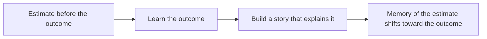

# Hindsight bias

## Summary

Hindsight bias is the tendency, after an outcome is known, to believe that it was predictable and that one had foreseen it. It makes past events seem inevitable and makes people overrate their own foresight and underrate how uncertain the situation was. It affects judgments of blame, learning from mistakes and the assessment of decisions. Giving people the outcome changes what they remember about their earlier estimates.

*This note is educational.*

## Prerequisites

- [Heuristics and cognitive biases](heuristics-and-biases.md).

## Core concepts

### Definition

*Hindsight bias* (the "knew-it-all-along effect") is the change in judgment of an event's probability after learning that it happened. Fischhoff (1975) showed that people who were told the outcome of an historical event rated that outcome as more likely than people who were not told, and could not ignore what they knew. Roese and Vohs (2012) distinguish three levels: memory distortion (misremembering one's earlier estimate), inevitability (the event had to happen) and foreseeability (I knew it would happen).

### Analogy

A detective story read a second time shows the clues, and they seem obvious. The first reader did not know which clues mattered. The limit of the analogy is that the book does not change, while the memory of one's own earlier estimate does.

### Mechanism

Making sense of the outcome creates a coherent story, and the story makes alternatives seem less likely.

## Worked example

Before a match, a fan estimates the probability of a win by the home team as 40%. The team wins. Asked a week later, the fan recalls an estimate of 65%.

| Time | Stated probability |
| --- | --- |
| Before the match | 40% |
| Recalled after the win | 65% |
| Distortion | +25 points |

The fan feels that the result was obvious, so the 40% looks like a mistake. A record of the estimate made at the time prevents this: a written forecast journal lets decisions be judged on the information that existed when they were made.

## Trade offs and when to use it

The bias is a useful reminder when reviewing decisions, for example in post-mortems, medical reviews and legal judgments, where outcome knowledge changes blame. Remedies: write down predictions and reasons beforehand, consider alternative outcomes that could have happened, and judge the process and not only the result. The bias is hard to remove, and warnings alone have little effect.

## Common mistakes

- **Judging a decision by its outcome.** A good decision can have a bad result.
- **Believing that one's memory of an old prediction is accurate.** It is rewritten.
- **Assuming that experts are immune.** They show the effect too.

## Practice

1. What are the three levels of hindsight bias?
2. Why is a written forecast useful?
3. What is wrong with judging a decision only by its outcome?

### Answers

1. Memory distortion, inevitability and foreseeability.
2. It preserves the estimate made before the outcome, so memory cannot change it.
3. It ignores the information available at the time and the role of chance.

## Further reading

- Fischhoff, B. (1975). Hindsight is not equal to foresight: The effect of outcome knowledge on judgment under uncertainty. *Journal of Experimental Psychology: Human Perception and Performance*, 1(3), 288-299. [DOI](https://doi.org/10.1037/0096-1523.1.3.288). The first experiments on hindsight bias.
- Roese, N. J. and Vohs, K. D. (2012). Hindsight Bias. *Perspectives on Psychological Science*, 7(5), 411-426. [DOI](https://doi.org/10.1177/1745691612454303). A review of hindsight bias, its three levels and its causes.
