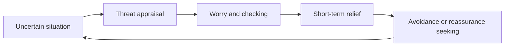

# Intolerance of uncertainty

## Summary

Uncertainty is the state of not knowing what will happen. Most people dislike it, and some find it so distressing that they worry, avoid decisions or seek endless reassurance. Researchers call this trait *intolerance of uncertainty* and link it to several anxiety disorders. Psychology distinguishes risk (known odds), ambiguity (unknown odds) and uncertainty about the future in general, and each calls for a different response.

*This note is educational. It is not mental health advice.*

## Prerequisites

- [Signal detection theory](signal-detection-theory.md) for decisions under noisy evidence.

## Core concepts

### Definition

*Intolerance of uncertainty* is a dispositional tendency to react negatively, on an emotional, cognitive and behavioral level, to uncertain situations and events. Carleton (2016) argues that fear of the unknown is a fundamental fear that underlies many anxiety conditions, and that intolerance of uncertainty is a way of measuring it. Three kinds of not knowing differ:

| Kind | Meaning | Example |
| --- | --- | --- |
| Risk | The outcomes and their probabilities are known | A fair die |
| Ambiguity | The probabilities are unknown | An urn of unknown composition |
| General uncertainty | Future events cannot be foreseen at all | A new job in a new city |

### Analogy

Uncertainty is fog on a road. Some drivers slow down and go on, and others stop and wait for the fog to lift, which it may not do. The limit of the analogy is that waiting costs something, and in life the fog often lifts only when you move.

### The cycle of worry

Short-term relief maintains the pattern, since the person never learns that the situation could be tolerated.

### Ways of responding

- **Separate what can be known from what cannot.** Gather information until the value of more falls.
- **Plan for a range.** Prepare for several outcomes, and not for a single prediction.
- **Practice small exposures.** Make small decisions without full information.
- **Seek professional help** when worry is persistent or interferes with daily life. Cognitive behavioral therapy has the strongest evidence for anxiety disorders (Hofmann et al., 2012).

## Worked example

A person has to decide on a job offer in a different city and cannot know whether it will work out. The steps:

| Step | Question | Result |
| --- | --- | --- |
| 1 | What can I find out? | Pay, team, cost of living: found out |
| 2 | What cannot be known? | How I will feel in a year |
| 3 | What range of outcomes? | Good, mixed, poor |
| 4 | What is reversible? | I can leave after a year, with a cost of one move |
| 5 | Decide | Accept, and set a review date |

The decision uses a range and a review point and does not wait for certainty, which does not come.

## Trade offs and when to use it

Some intolerance of uncertainty is useful, because it prompts planning and caution. Too much leads to avoidance and delay. The aim is not comfort with all uncertainty, but the ability to act well without full knowledge.

## Common mistakes

- **Waiting for certainty.** It rarely arrives.
- **Mistaking reassurance for resolution.** It gives relief for a short time.
- **Treating risk and ambiguity as the same.** They need different tools.

## Practice

1. Distinguish risk from ambiguity.
2. Why does avoidance keep the problem going?
3. What is one practical response?

### Answers

1. In risk the probabilities are known. In ambiguity they are unknown.
2. It gives short-term relief and prevents learning that the situation can be tolerated.
3. Plan for a range of outcomes and set a review point.

## Further reading

- Carleton, R. N. (2016). Fear of the unknown: One fear to rule them all?. *Journal of Anxiety Disorders*, 41, 5-21. [DOI](https://doi.org/10.1016/j.janxdis.2016.03.011). Argues that intolerance of uncertainty is a fundamental fear behind anxiety disorders.
- Hofmann, S. G., Asnaani, A., Vonk, I. J. J. et al. (2012). The Efficacy of Cognitive Behavioral Therapy: A Review of Meta-analyses. *Cognitive Therapy and Research*, 36(5), 427-440. [DOI](https://doi.org/10.1007/s10608-012-9476-1). A review of 106 meta-analyses on the efficacy of cognitive behavioral therapy.
