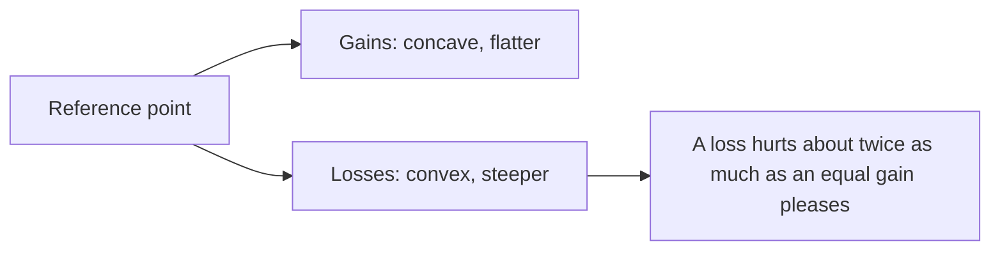

# Loss aversion

## Summary

Loss aversion is the finding that a loss weighs more heavily in a decision than a gain of the same size. In prospect theory, losses count about twice as much as equal gains. The pattern explains why people reject fair gambles, hold losing investments and prefer the status quo. The exact size of the effect varies by task and person, and some researchers argue that it is smaller in some settings.

*This note is educational. It is not investment advice.*

## Prerequisites

- [Heuristics and cognitive biases](heuristics-and-biases.md).

## Core concepts

### Definition

*Loss aversion* is the asymmetry of the value function of prospect theory (Kahneman and Tversky, 1979): the function is steeper for losses than for gains, and both sides show diminishing sensitivity. Tversky and Kahneman (1992) estimated a loss aversion coefficient of about 2.25 and a curvature of 0.88 for their participants. Values are measured from a reference point, such as the current wealth or an expectation, and not from zero.

### Analogy

A loss is a louder sound than a gain of the same volume. A person whose hearing is tuned like this needs a gain roughly twice as large to accept the risk of a loss. The limit of the analogy is that a loudness setting is fixed, while the reference point and the coefficient change with context.

### The value function



## Worked example

The code uses the estimates of Tversky and Kahneman (1992) to value a coin flip in which a person wins 100 or loses 100.

```python
# Python 3.12. Prospect theory value function with the estimates of Tversky and Kahneman (1992).
ALPHA, LAMBDA = 0.88, 2.25          # diminishing sensitivity; loss aversion coefficient

def value(x):
    return x ** ALPHA if x >= 0 else -LAMBDA * (-x) ** ALPHA

print(round(value(100), 1), round(value(-100), 1))
print("coin flip, win 100 or lose 100:", round(0.5 * value(100) + 0.5 * value(-100), 1))
win = 100
while 0.5 * value(win) + 0.5 * value(-100) < 0:   # smallest win that makes the flip acceptable
    win += 1
print("smallest acceptable win against a loss of 100:", win)
```

Output:

```text
57.5 -129.5
coin flip, win 100 or lose 100: -36.0
smallest acceptable win against a loss of 100: 252
```

A fair coin flip has an expected money value of zero and a negative subjective value of -36. The model says that this person needs a possible gain of about 252 to accept a possible loss of 100, which is more than twice the loss because of the curvature. The figures depend on the parameters, and real people differ.

## Trade offs and when to use it

The concept helps explain the endowment effect, the disposition effect (selling winners and holding losers) and resistance to change. It also supports framing choices as losses of the status quo to motivate action. Limits: the coefficient is not a constant, and the effect shrinks when stakes are small or choices are repeated, and it is debated how much of the pattern is loss aversion and how much is another cause such as status quo bias.

## Common mistakes

- **Using 2.25 as a law.** It is an estimate from one set of studies.
- **Confusing loss aversion with risk aversion.** The first is about the weight of losses, the second about preferring a sure outcome.
- **Ignoring the reference point.** The same outcome is a loss or a gain depending on expectation.

## Practice

1. What does the coefficient 2.25 say?
2. Why is a fair coin flip unattractive under prospect theory?
3. What is a reference point?

### Answers

1. Losses weigh about 2.25 times as much as gains of the same size, in the estimates of Tversky and Kahneman (1992).
2. The loss side of the value function is steeper, so the negative value of the loss outweighs the gain.
3. The level from which gains and losses are measured, such as current wealth or an expectation.

## Further reading

- Kahneman, D. and Tversky, A. (1979). Prospect Theory: An Analysis of Decision under Risk. *Econometrica*, 47(2), 263. [DOI](https://doi.org/10.2307/1914185). The original statement of prospect theory, including loss aversion.
- Tversky, A. and Kahneman, D. (1992). Advances in prospect theory: Cumulative representation of uncertainty. *Journal of Risk and Uncertainty*, 5(4), 297-323. [DOI](https://doi.org/10.1007/BF00122574). Cumulative prospect theory, which gives the usual estimates of loss aversion and diminishing sensitivity.
- Kahneman, D. (2011). *Thinking, Fast and Slow*. Farrar, Straus and Giroux. A general account of heuristics, biases and the two modes of thinking.
