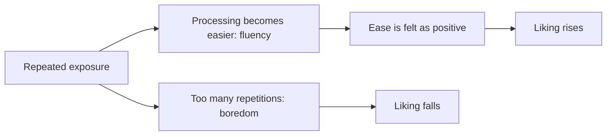

# Mere exposure effect

## Summary

The mere exposure effect is the finding that repeated exposure to a stimulus, with no reward, increases how much people like it. It was shown by Zajonc in 1968 with nonsense words, symbols and faces, and a meta-analysis confirmed it across many studies. The effect is strongest at brief, repeated, even unnoticed exposure, and it fades or reverses with too many repetitions. It explains part of the pull of familiar brands, songs and people.

*This note is educational.*

## Prerequisites

- [Heuristics and cognitive biases](heuristics-and-biases.md).

## Core concepts

### Definition

The *mere exposure effect* is an increase in positive attitude toward a stimulus after repeated exposure to it (Zajonc, 1968). Bornstein (1989) analyzed the studies from 1968 to 1987 and found a reliable effect, larger for brief exposure, and larger when the participants did not consciously recognize the stimuli.

### Analogy

A path that is walked every day starts to feel like the right way home, even if another route is shorter. The limit of the analogy is that the effect holds without any benefit of the path at all, and it is about liking, not about efficiency.

### Mechanism

A common explanation is that familiar stimuli are processed more easily, and that ease feels pleasant. The plot of liking against repetitions is often an inverted U.

## Worked example

A company runs a short ad 5 times a week. In the first weeks, recognition and liking of the brand increase. After many weeks, the audience shows signs of wear-out, so the advertiser changes the ad. The pattern can be sketched as a table of liking against exposures (illustrative values).

| Exposures | Liking (0-10, illustrative) |
| --- | --- |
| 0 | 4.0 |
| 5 | 5.5 |
| 15 | 6.5 |
| 40 | 5.8 |

The values illustrate the inverted U of the research, and they are not data from a study.

## Trade offs and when to use it

Use the effect to explain why familiarity breeds comfort in marketing, design and teams that meet often. It does not mean that more exposure is always better, and it does not work if the first impression is negative. Effects on attraction to people need positive first interactions.

## Common mistakes

- **Assuming that more is always better.** Wear-out sets in.
- **Using it with a negative first impression.** Exposure can strengthen dislike.
- **Mistaking familiarity for quality.** The effect says nothing about merit.

## Practice

1. Who showed the mere exposure effect first?
2. Why does fluency explain it?
3. When does it reverse?

### Answers

1. Zajonc (1968).
2. Familiar stimuli are processed more easily, and ease is felt as pleasant.
3. With too many repetitions, which cause boredom, or when the first contact was negative.

## Further reading

- Zajonc, R. B. (1968). Attitudinal effects of mere exposure. *Journal of Personality and Social Psychology*, 9(2, Pt.2), 1-27. [DOI](https://doi.org/10.1037/h0025848). The classic paper on the mere exposure effect.
- Bornstein, R. F. (1989). Exposure and affect: Overview and meta-analysis of research, 1968-1987. *Psychological Bulletin*, 106(2), 265-289. [DOI](https://doi.org/10.1037/0033-2909.106.2.265). A meta-analysis of mere exposure studies.
