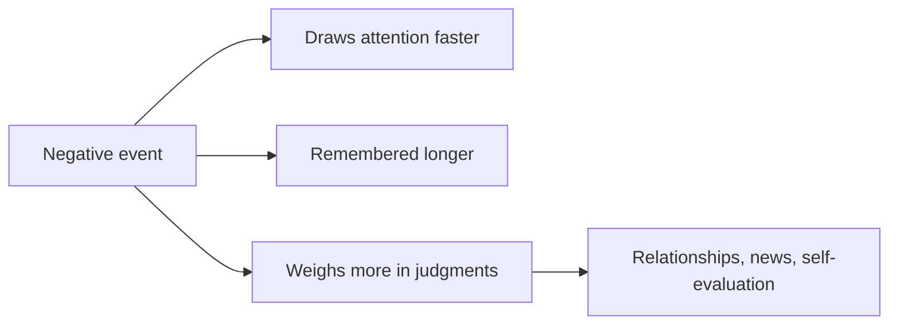

# Negativity bias

## Summary

Negativity bias is the tendency for negative events, information and feelings to have a larger effect on attention, memory and judgment than positive ones of the same size. A review of the research concludes that bad is stronger than good in many areas, from first impressions to relationships. It has an evolutionary logic, since missing a threat costs more than missing a reward. It can distort how people see their own lives and the news.

*This note is educational. It is not mental health advice.*

## Prerequisites

- [Heuristics and cognitive biases](heuristics-and-biases.md).

## Core concepts

### Definition

*Negativity bias* is the finding that negative stimuli are given more weight than positive stimuli of equal intensity. Baumeister and colleagues (2001) reviewed studies of events, feedback, impressions, emotions and relationships, and found that bad events tend to have stronger and longer effects than good ones. Rozin and Royzman (2001) separate four aspects: negative potency, steeper gradients, negativity dominance and negative differentiation.

### Analogy

A smoke alarm that is set to be sensitive goes off more often than needed, but it is better than one that misses a fire. The limit of the analogy is that an alarm in a house has one purpose, while in daily life the same sensitivity can lower mood when it reacts to small events.

### Where it shows

## Worked example

A manager gives an employee nine positive comments and one negative comment in a review. Which does the employee remember?

| Comment | Count | Weight in memory (illustrative) |
| --- | --- | --- |
| Positive | 9 | Low each |
| Negative | 1 | High |

Many people recall the negative comment best. A manager can account for this by stating negative points specifically and briefly, by pairing them with a way to improve, and by not relying on a single positive remark to balance them. The weights are an illustration of the pattern and not measured values.

## Trade offs and when to use it

The bias helps in danger detection and in learning from mistakes. It harms when it leads to constant worry, to the belief that the world is worse than it is, or to avoidance of reasonable risks. Counter-measures include keeping a record of good events, looking at base rates and limiting exposure to negative news. They address the habit, and they do not remove the bias.

## Common mistakes

- **Treating it as pessimism.** It is a pattern of weighting that applies to most people.
- **Trying to ignore the negative.** Real problems still need attention.
- **Assuming that positive feedback cancels negative feedback one for one.** The effects are not symmetrical.

## Practice

1. State the main finding of Baumeister and colleagues (2001).
2. Why might the bias be adaptive?
3. Name one counter-measure.

### Answers

1. Bad events and information have stronger and longer effects than good ones across many areas.
2. Missing a threat costs more than missing a reward.
3. Keep a record of good events, or check base rates.

## Further reading

- Baumeister, R. F., Bratslavsky, E., Finkenauer, C. et al. (2001). Bad is Stronger than Good. *Review of General Psychology*, 5(4), 323-370. [DOI](https://doi.org/10.1037/1089-2680.5.4.323). Reviews evidence that negative events weigh more than positive ones.
- Rozin, P. and Royzman, E. B. (2001). Negativity Bias, Negativity Dominance, and Contagion. *Personality and Social Psychology Review*, 5(4), 296-320. [DOI](https://doi.org/10.1207/S15327957PSPR0504_2). Reviews negativity bias, negativity dominance and contagion across psychology.
