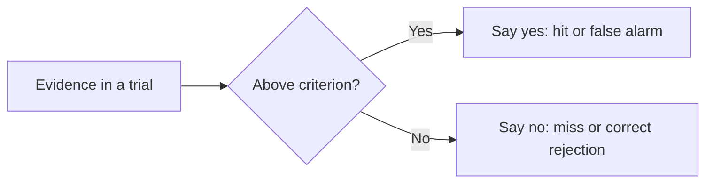

# Signal detection theory

## Summary

Signal detection theory describes how an observer decides whether a faint signal is present in noise. It separates two things that raw accuracy mixes: sensitivity (how well the observer can tell signal from noise) and the response criterion (how willing the observer is to say "yes"). The theory replaced the older idea of a fixed perception threshold, and it is used in medicine, security screening, memory research and machine learning.

*This note is educational.*

## Prerequisites

No prior notes are needed.

## Core concepts

### Definition

In a yes-or-no task there are four outcomes: a *hit* (signal present, observer says yes), a *miss* (present, says no), a *false alarm* (absent, says yes) and a *correct rejection* (absent, says no). Green and Swets (1966) treat the evidence in each trial as a random variable: noise alone gives one distribution, signal plus noise gives another distribution with a higher mean. The observer says yes when the evidence passes a criterion.

- **Sensitivity** (*d'*, d prime) is the distance between the two distributions in standard deviation units. It is d' = z(hit rate) - z(false alarm rate).
- **Criterion** (*c*) is the position of the cutoff. A positive c means a conservative observer who says yes less often.

### Analogy

A smoke detector has a dial. Turned to high sensitivity, it catches every fire and also sounds for toast. Turned low, it ignores toast and may miss a small fire. The quality of the sensor is one thing, and the position of the dial is another. The limit of the analogy is that a human observer's dial moves with costs, expectations and fatigue.

### Why a fixed threshold fails

Older psychophysics assumed an *absolute threshold*: below it, no sensation. Signal detection theory shows that the same observer can detect a given stimulus on one day and not on another because the criterion changed, with the sensitivity unchanged. The *just noticeable difference* is similarly a statistical quantity and not a sharp line.



## Worked example

Two screeners look at the same scans. One is cautious, and one says yes more readily. The code computes d' and c from their hit and false alarm rates (Stanislaw and Todorov, 1999).

```python
# Python 3.12. Signal detection: sensitivity (d') and criterion (c) from hit and false alarm rates.
from statistics import NormalDist

z = NormalDist().inv_cdf

def measures(hit_rate, fa_rate):
    d_prime = z(hit_rate) - z(fa_rate)
    criterion = -(z(hit_rate) + z(fa_rate)) / 2
    return round(d_prime, 2), round(criterion, 2)

# two screeners look at the same scans, with the same sensitivity and different willingness to say "yes"
print("cautious:", measures(0.69, 0.07))
print("liberal :", measures(0.93, 0.31))
```

Output:

```text
cautious: (1.97, 0.49)
liberal : (1.97, -0.49)
```

The liberal screener has a higher hit rate (93% against 69%) and a higher false alarm rate (31% against 7%). A comparison of hit rates alone would call the liberal screener better. Both have the same sensitivity of 1.97, and they differ only in the criterion, which is +0.49 for the cautious one and -0.49 for the liberal one.

## Trade offs and when to use it

Use the theory when you evaluate any yes/no judgment under uncertainty: diagnostic tests, fraud alerts, eyewitness identification, spam filters. The right criterion depends on the costs: a screening test should be liberal when a miss is costly, and a test that triggers an invasive step should be conservative. Limits: the standard model assumes equal-variance normal distributions, and real data may not fit.

## Common mistakes

- **Judging by hit rate alone.** A high hit rate can come from a liberal criterion.
- **Treating the criterion as a flaw.** It should follow the costs of errors.
- **Confusing d' with accuracy.** Accuracy depends on both d' and the criterion.

## Practice

1. Define a false alarm.
2. What does d' measure?
3. Two observers have equal d' but different hit rates. What differs?

### Answers

1. Saying yes when the signal is absent.
2. How well the observer separates signal from noise, in standard deviations.
3. The criterion, which is the willingness to say yes.

## Further reading

- Green, D. M. and Swets, J. A. (1966). *Signal Detection Theory and Psychophysics*. Wiley. The standard text of signal detection theory.
- Stanislaw, H. and Todorov, N. (1999). Calculation of signal detection theory measures. *Behavior Research Methods*, Instruments, & Computers, 31(1), 137-149. [DOI](https://doi.org/10.3758/BF03207704). A practical guide to calculating d prime and bias.
