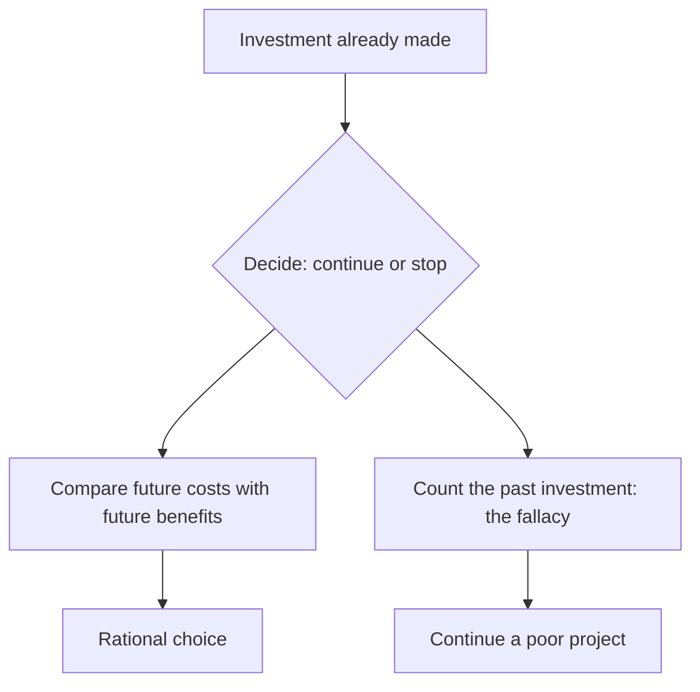

# Sunk cost fallacy

## Summary

A sunk cost is money, time or effort that has already been spent and cannot be recovered. The sunk cost fallacy is the tendency to let it influence a decision about the future, such as continuing a failing project because of what was already invested. A rational decision compares only future costs and future benefits. The fallacy is common in projects, relationships and purchases, and it can be reduced by changing how the decision is framed.

*This note is educational. It is not financial advice.*

## Prerequisites

- [Heuristics and cognitive biases](heuristics-and-biases.md).

## Core concepts

### Definition

The *sunk cost effect* is a greater tendency to continue an endeavor once an investment has been made (Arkes and Blumer, 1985). In their experiments, people who had paid more for a season ticket used it more often, and people said they would continue a project that was already 90% funded even when a better alternative existed.

### Analogy

Sunk costs are like water that has already gone over a dam. Standing at the bottom and trying to get it back does not help, and the only question is what to do with the water that is still behind the dam. The limit of the analogy is that effort and money spent can also change a person's reputation or learning, and these effects are part of the future and should be counted.

### Mechanism

Several motives drive it: aversion to a loss that stopping would make real, the wish not to appear wasteful, and the wish to be consistent with earlier choices.

## Worked example

A company has spent 800,000 on software and needs 300,000 more to finish it. The finished product is expected to bring 250,000 in value. An alternative product can be bought for 100,000 and would bring the same 250,000.

| Option | Future cost | Future value | Net future result |
| --- | --- | --- | --- |
| Finish the old software | 300,000 | 250,000 | -50,000 |
| Buy the alternative | 100,000 | 250,000 | +150,000 |

The 800,000 is the same under both options, so it does not affect the choice. The alternative is better by 200,000, and a manager who says "we cannot waste 800,000" is counting a cost that no option can recover.

## Trade offs and when to use it

Ignoring the past is correct for the money, but the past can carry information: a project that is more costly than planned is evidence about the next estimate. Reputation, contracts and learning belong in the future calculation. Tools that help: ask "if I were starting today, would I choose this?", set stopping criteria in advance, and ask someone with no stake in the history.

## Common mistakes

- **Counting sunk costs as an argument to continue.** They are equal for all options.
- **Treating quitting as a failure.** Stopping a bad project is a decision with a better result.
- **Ignoring real future effects.** Penalties for withdrawal and reputational costs are not sunk.

## Practice

1. What is a sunk cost?
2. A ticket cost 50 and you do not feel well. Why is the price irrelevant to whether you go?
3. Name one way to reduce the fallacy.

### Answers

1. A cost already incurred that cannot be recovered whatever you choose.
2. The 50 is spent either way, and only the future enjoyment and cost count.
3. Ask whether you would start the project today, set stopping criteria in advance, or ask someone with no stake.

## Further reading

- Arkes, H. R. and Blumer, C. (1985). The psychology of sunk cost. *Organizational Behavior and Human Decision Processes*, 35(1), 124-140. [DOI](https://doi.org/10.1016/0749-5978(85)90049-4). Field and lab studies of the sunk cost effect.
- Kahneman, D. (2011). *Thinking, Fast and Slow*. Farrar, Straus and Giroux. A general account of heuristics, biases and the two modes of thinking.
