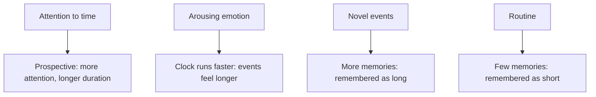

# Time perception

## Summary

People do not read time from a single clock. The brain builds a sense of duration from several mechanisms, and that sense bends with attention, emotion, age and memory. Boring waiting seems long and absorbing activity seems short, while in memory the relation reverses: a period full of new events is remembered as long. Time perception explains why the same hour can feel different, and why the years seem to pass faster with age.

*This note is educational.*

## Prerequisites

No prior notes are needed.

## Core concepts

### Definition

*Time perception* is the experience and the estimate of the passage and duration of time. Researchers separate *prospective* judgments (made while a person knows that time will be judged) from *retrospective* ones (made afterwards, from memory). The two respond differently to the same conditions. Wittmann (2013) reviews how the brain represents duration, and concludes that no single clock exists: several systems, such as the basal ganglia, cerebellum and insula, contribute, depending on the time scale.

### Analogy

Time perception is like a rubber ruler. Used in different situations it stretches and shrinks, and the marks stay in the same order. The limit of the analogy is that the stretching also depends on how one looks back at the measurement.

### What bends the sense of time

- **Attention.** The more attention goes to the passage of time, the longer a period feels while it is lived (prospective judgment).
- **Emotion.** Droit-Volet and Gil (2009) describe a time-emotion paradox: arousing emotions such as fear or anger make durations seem longer, in line with a faster internal pace, while judgments depend on attention to the emotion and on the context.
- **Memory.** Retrospective duration depends on how many distinct memories a period left. A week of travel is remembered as longer than a week of routine.
- **Age.** Many people report that years pass faster as they age. Explanations include proportional ideas (a year is a smaller part of a longer life) and fewer new events, and the evidence for any one is incomplete.

## Worked example

Two Saturdays. In the first, a person waits 20 minutes in a queue and keeps checking the clock. In the second, the same person spends two hours on a hobby with full attention.

| Situation | During (prospective) | Looking back (retrospective) |
| --- | --- | --- |
| Queue, watching the clock | Feels very long | Short, as it left few memories |
| Hobby with full attention | Feels short | Moderate, with several memories |

Prospective and retrospective judgments can point in opposite directions. The table shows the pattern in qualitative terms, and it is not a measurement.

## Trade offs and when to use it

Knowing these effects helps with planning and with experience design: queues feel shorter with distractions, and a holiday feels longer in memory when it contains varied events. The estimates of duration are unreliable in stress, in monotonous work and with strong emotion, so safety-critical tasks use clocks. Many claims about "slowing time" in danger are about memory and not about faster perception.

## Common mistakes

- **Assuming one internal clock.** Several mechanisms contribute.
- **Mixing prospective and retrospective judgments.** They behave differently.
- **Using a single reason for the acceleration with age.** The causes are debated.

## Practice

1. Which judgment depends on memory, prospective or retrospective?
2. Why does a novel holiday seem long in memory?
3. What does arousing emotion do to felt duration?

### Answers

1. Retrospective.
2. It creates many distinct memories, and the number of memories shapes remembered duration.
3. It tends to lengthen felt duration, as if the internal pace is faster.

## Further reading

- Wittmann, M. (2013). The inner sense of time: how the brain creates a representation of duration. *Nature Reviews Neuroscience*, 14(3), 217-223. [DOI](https://doi.org/10.1038/nrn3452). A review of how the brain represents duration.
- Droit-Volet, S. and Gil, S. (2009). The time-emotion paradox. *Philosophical Transactions of the Royal Society B: Biological Sciences*, 364(1525), 1943-1953. [DOI](https://doi.org/10.1098/rstb.2009.0013). Reviews how emotion changes the perception of duration.
