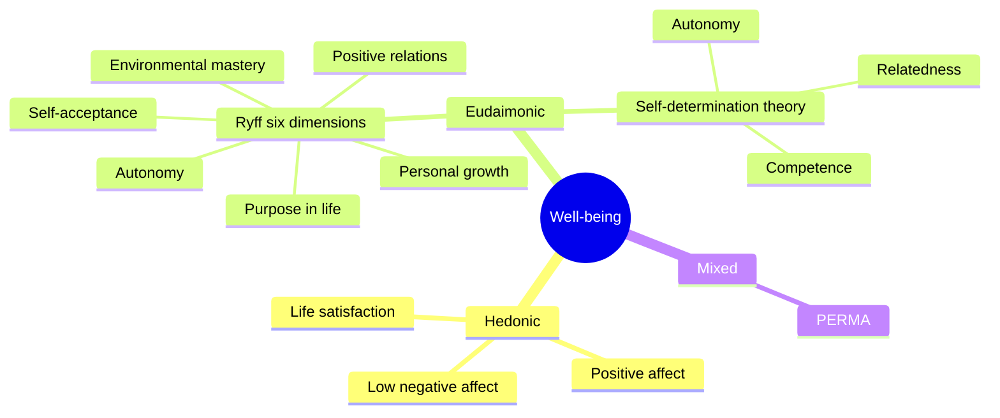
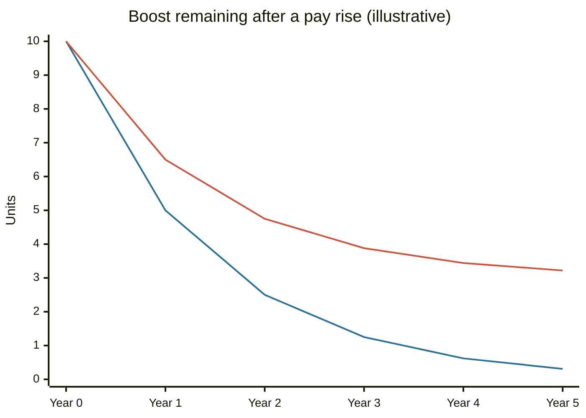

# Hedonic and eudaimonic well-being

## Summary

Psychologists describe two traditions of happiness. Hedonic well-being is about pleasure, positive feelings and satisfaction with life. Eudaimonic well-being is about meaning, growth, purpose and living in line with one's values. The two overlap and predict somewhat different outcomes, so most researchers treat them as complementary. Popular claims that tie each to a specific brain chemical or gene profile are not established.

*This note is educational. It is not mental health advice.*

## Prerequisites

No prior notes are needed. [Maslow's hierarchy of needs](maslow-hierarchy-of-needs.md) gives the idea of self-actualization that the eudaimonic tradition builds on.

## Core concepts

### Definition

*Well-being* is the umbrella term for how well a person's life is going, as the person experiences it and as it can be judged against a standard. Two traditions describe it:

- **Hedonic well-being.** Pleasure and the absence of pain. Researchers measure it as frequent positive affect, infrequent negative affect and a high rating of life satisfaction. Together these form *subjective well-being*.
- **Eudaimonic well-being.** Fulfilling one's potential and living a meaningful life. The word comes from Aristotle's *eudaimonia*, usually translated as flourishing and not as a feeling. Researchers measure it with scales of purpose, growth, autonomy and mastery.

Ryan and Deci (2001) organized the research of the field around this split, and Huta and Waterman (2014) later showed that studies use the two words in many different ways, so a claim about "eudaimonia" always needs a check of how it was measured.

### Origins

The hedonic tradition goes back to the Greek philosophers Aristippus and Epicurus, and later to the utilitarians Jeremy Bentham and John Stuart Mill. The eudaimonic tradition goes back to Aristotle's *Nicomachean Ethics*, and in psychology it appears in Maslow's self-actualization, Erikson's work on identity, self-determination theory and Ryff's model.

### Analogy

Hedonic well-being is the fuel gauge and eudaimonic well-being is the destination. A car with a full tank and no destination drives in circles, and a car with a destination and no fuel stops. The limit of the analogy is that fuel is a separate thing from the trip, while in practice a meaningful activity often feels good too.

### Models of eudaimonic well-being



The map shows how the main models sort into the two traditions. Ryff (1989) proposed six dimensions of psychological well-being. Self-determination theory (Ryan and Deci, 2001) names three basic needs: autonomy, competence and relatedness. Seligman's PERMA model (2011) lists five elements: positive emotion, engagement, relationships, meaning and accomplishment. PERMA mixes both traditions.

### Comparison

| Dimension | Hedonic | Eudaimonic |
| --- | --- | --- |
| Core idea | Pleasure, comfort, positive feeling | Meaning, purpose, growth |
| Typical measure | Positive and negative affect, life satisfaction | Scales of purpose, autonomy, mastery |
| Time scale | Moments and moods | Years and life direction |
| Effort | Often low | Often high |
| Examples | A good meal, rest, entertainment | Learning a craft, caring for others, long projects |
| Risk when alone | Escapism, emptiness | Strain, perfectionism, guilt |

### Adaptation

*Hedonic adaptation* is the return of well-being toward a baseline after a change. In a famous study, Brickman, Coates and Janoff-Bulman (1978) compared lottery winners, accident victims and controls and argued that people adapt. Later panel studies show that the picture is more complicated. Lucas (2007) reviewed them and concluded that adaptation is real but incomplete: events such as divorce, widowhood or unemployment are followed by lasting changes for many people, and people differ in how much they adapt.

### Evidence and its limits

- Self-determination research and Ryff's work link meaning and autonomy to health and long-term outcomes. Most of these studies are correlational, so they do not show that meaning causes the better outcomes.
- Fredrickson and colleagues (2013) reported that hedonic and eudaimonic well-being were linked to opposite patterns of immune gene expression. Brown and colleagues (2014) reanalyzed the data and argued that the statistical analysis was seriously flawed. Treat this result as unresolved.
- The statements that pleasure comes from "dopamine spikes" and meaning from "serotonin pathways" are popular simplifications. This note does not rely on them.

## Worked example

A toy model shows why adaptation matters for planning. A pay rise lifts well-being by 10 units. In each year, half of the remaining boost fades. In the first run all of the boost fades in the long run (full adaptation). In the second run 30% of the boost is permanent (incomplete adaptation, the pattern Lucas describes for some life events). The numbers are invented for illustration.

```python
# Python 3.12. Toy model of a one-time boost to well-being.
boost, fade = 10, 0.5          # initial boost; share of the remaining boost that fades each year
def level(year, permanent):
    kept = boost * permanent
    return kept + (boost - kept) * (1 - fade) ** year
for permanent in (0.0, 0.3):
    print(permanent, [round(level(y, permanent), 2) for y in range(6)])
```

Output:

```text
0.0 [10.0, 5.0, 2.5, 1.25, 0.62, 0.31]
0.3 [10.0, 6.5, 4.75, 3.88, 3.44, 3.22]
```



The first line is full adaptation and the second line is 30% permanent. The model says little about real people. It shows that the size of the permanent part, which differs by event and by person, decides how much a change is worth over time.

## Trade offs and when to use it

The distinction helps to ask two questions about a life or a plan: does it contain enough enjoyment, and does it have direction? Pleasure without direction tends to fade, and direction without enjoyment is hard to sustain. One informal plan, which is the author's suggestion and not a research result, is small daily pleasures, a recurring project with meaning each week, and a longer view of who one wants to become. The distinction is not a ranking: pleasure is a normal and necessary part of well-being.

## Common mistakes

- **Treating hedonic well-being as shallow.** Positive affect is part of health and of recovery from stress.
- **Treating happiness as a target.** Studies of well-being treat it as a state that depends on circumstances, activities and relationships.
- **Quoting brain-chemistry explanations as facts.** The mechanisms are not settled.
- **Reading correlations as causes.** Healthier people may also find more meaning.
- **Confusing one's own goals with values.** Goals imposed by others ("shoulds") do not give the benefits of self-endorsed goals in self-determination research.

## Practice

1. What does *eudaimonia* mean in Aristotle?
2. Name Ryff's six dimensions of psychological well-being.
3. What did Lucas (2007) conclude about adaptation?

### Answers

1. Flourishing, or living well in line with virtue, rather than a feeling of pleasure.
2. Self-acceptance, positive relations with others, autonomy, environmental mastery, purpose in life and personal growth.
3. Adaptation is real but incomplete. Some events have lasting effects, and people differ in how much they adapt.

## Further reading

- Ryan, R. M. and Deci, E. L. (2001). On happiness and human potentials: a review of research on hedonic and eudaimonic well-being. *Annual Review of Psychology*, 52, 141-166. [DOI](https://doi.org/10.1146/annurev.psych.52.1.141). The standard review that separates the hedonic and eudaimonic traditions.
- Ryff, C. D. (1989). Happiness is everything, or is it? Explorations on the meaning of psychological well-being. *Journal of Personality and Social Psychology*, 57(6), 1069-1081. [DOI](https://doi.org/10.1037/0022-3514.57.6.1069). Proposes six dimensions of psychological well-being.
- Waterman, A. S. (1993). Two conceptions of happiness: contrasts of personal expressiveness (eudaimonia) and hedonic enjoyment. *Journal of Personality and Social Psychology*, 64(4), 678-691. [DOI](https://doi.org/10.1037/0022-3514.64.4.678). Early empirical comparison of the two kinds of happiness.
- Huta, V. and Waterman, A. S. (2014). Eudaimonia and its distinction from hedonia: developing a classification and terminology for understanding conceptual and operational definitions. *Journal of Happiness Studies*, 15(6), 1425-1456. [DOI](https://doi.org/10.1007/s10902-013-9485-0). Sorts the many definitions of the two terms.
- Brickman, P., Coates, D. and Janoff-Bulman, R. (1978). Lottery winners and accident victims: is happiness relative?. *Journal of Personality and Social Psychology*, 36(8), 917-927. [DOI](https://doi.org/10.1037/0022-3514.36.8.917). The classic study behind the idea of hedonic adaptation.
- Lucas, R. E. (2007). Adaptation and the set-point model of subjective well-being. *Current Directions in Psychological Science*, 16(2), 75-79. [DOI](https://doi.org/10.1111/j.1467-8721.2007.00479.x). Shows that adaptation is real but incomplete, and that people differ in it.
- Seligman, M. E. P. (2011). *Flourish: A Visionary New Understanding of Happiness and Well-being*. Free Press. Sets out the PERMA model of well-being.
- Aristotle. *Nicomachean Ethics*. Many editions; written in the 4th century BCE. The origin of the concept of eudaimonia.
- Fredrickson, B. L., Grewen, K. M., Coffey, K. A. et al. (2013). A functional genomic perspective on human well-being. *Proceedings of the National Academy of Sciences*, 110(33), 13684-13689. [DOI](https://doi.org/10.1073/pnas.1305419110). Reported different gene expression profiles for hedonic and eudaimonic well-being.
- Brown, N. J. L., MacDonald, D. A., Samanta, M. P. et al. (2014). A critical reanalysis of the relationship between genomics and well-being. *Proceedings of the National Academy of Sciences*, 111(35), 12705-12709. [DOI](https://doi.org/10.1073/pnas.1407057111). A reanalysis that disputes the genomic result above.
