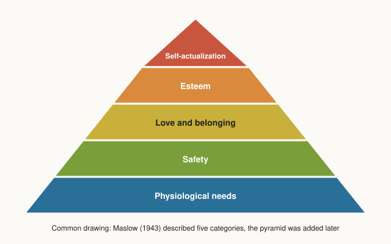

# Maslow's hierarchy of needs

## Summary

Abraham Maslow proposed in 1943 that human motives fall into five groups: physiological needs, safety, love and belonging, esteem and self-actualization. His central idea is that a need which is badly unmet dominates attention, and that higher needs become prominent once lower ones are reasonably satisfied. The pyramid in textbooks was drawn by later authors. The ordering as a strict ladder is not well supported by research, while the claim that all these needs matter for well-being across the world is.

*This note is educational. It is not psychological advice.*

## Prerequisites

No prior notes are needed.

## Core concepts

### Definition

Maslow's *hierarchy of needs* is a theory of motivation that groups human needs into five levels and says they are arranged by *prepotency*: the most urgent unmet need organizes behavior, and when it is satisfied the next one comes forward. The original paper presents the needs as a hierarchy of relative urgency, not as a rigid sequence that must be completed before the next level starts.

### Analogy

The hierarchy works like the pressure of competing alarms in a house. A fire alarm drowns out the doorbell, and when the fire is out the doorbell becomes the loudest sound. The limit of the analogy is that needs are not a set of discrete alarms. They can sound together, and a person may pursue a creative goal while still hungry.

### The five levels

The figure shows the common drawing. Maslow himself did not draw a pyramid. Bridgman, Cummings and Ballard (2019) traced how the picture was added in later management literature.

| Level | Meaning | Examples |
| --- | --- | --- |
| Physiological | Biological requirements for survival | Air, food, water, sleep, shelter, warmth |
| Safety | Protection and predictability | Physical security, health, stable income, freedom from fear |
| Love and belonging | Affection and membership | Family, friendship, intimacy, community |
| Esteem | Self-respect and the respect of others | Competence, achievement, recognition |
| Self-actualization | Realizing one's potential | Creative work, mastery, a calling |

### How the hierarchy is meant to work

The loop shows prepotency. Maslow also stated that satisfaction is partial: a person can be partly satisfied at one level while the next level is already active.

### Evidence

- **Universality.** Tay and Diener (2011) analyzed data from 123 countries. Fulfillment of needs was associated with well-being in every world region. Basic needs were most tied to evaluating one's life, and social and respect needs were most tied to positive feelings.
- **Ordering.** The same line of work, and an earlier review by Wahba and Bridwell (1976), found little support for the strict order. People pursue several needs at once, and the order differs between cultures and situations.
- **Later versions.** Koltko-Rivera (2006) documents that Maslow later placed self-transcendence, a motive that goes beyond the self, above self-actualization.
- **Self-actualization** is the hardest level to measure, because it is defined by a small number of case studies of admired people.

The status: the list of needs is a useful and widely supported classification. The strict hierarchy is a contested part of the theory.

## Worked example

A worker loses a job in a month when rent is due. The table shows how the needs compete.

| Need | State | Effect on behavior |
| --- | --- | --- |
| Physiological | Food and housing are secure for now | Not a source of concern |
| Safety | Income stopped and rent is due | Dominates: job search, budgeting |
| Belonging | Colleagues are no longer daily contacts | Weaker, felt as isolation |
| Esteem | Identity as a worker is threatened | Felt as shame or doubt |
| Self-actualization | Hobby projects continue in the evenings | Present, with little energy |

The safety need dominates, as the theory predicts. The belonging and esteem needs are still active, which shows the main weakness of a strict ladder: needs do not wait their turn.

## Trade offs and when to use it

The hierarchy is a quick checklist for asking what a person or an organization is missing, for example in management, education or product design. It is a weak predictor. It does not tell which need wins in a conflict, and it was derived from a small, mostly Western sample. Use it as a classification, not as a law.

## Common mistakes

- **Treating the pyramid as Maslow's own figure.** It was added later.
- **Reading it as a strict ladder.** The paper describes relative urgency and partial satisfaction.
- **Assuming that money buys the top levels.** The theory says nothing of the kind, and the research links well-being to needs at every level.
- **Treating self-actualization as a status to reach.** It is a direction of growth.

## Practice

1. What does prepotency mean?
2. Who drew the pyramid?
3. What did Tay and Diener (2011) find across 123 countries?

### Answers

1. The most urgent unmet need dominates behavior until it is reasonably satisfied.
2. Later authors in management literature. Maslow's 1943 paper does not contain it.
3. Need fulfillment was associated with well-being in all regions, and different needs were tied to different aspects of well-being.

## Further reading

- Maslow, A. H. (1943). A theory of human motivation. *Psychological Review*, 50(4), 370-396. [DOI](https://doi.org/10.1037/h0054346). The original paper that sets out the hierarchy of needs.
- Bridgman, T., Cummings, S. and Ballard, J. (2019). Who built Maslow's pyramid? A history of the creation of management studies' most famous symbol and its implications for management education. *Academy of Management Learning & Education*, 18(1), 81-98. [DOI](https://doi.org/10.5465/amle.2017.0351). Shows that Maslow never drew the pyramid, which later authors added.
- Koltko-Rivera, M. E. (2006). Rediscovering the later version of Maslow's hierarchy of needs: self-transcendence and opportunities for theory, research, and unification. *Review of General Psychology*, 10(4), 302-317. [DOI](https://doi.org/10.1037/1089-2680.10.4.302). Documents Maslow's later addition of self-transcendence above self-actualization.
- Tay, L. and Diener, E. (2011). Needs and subjective well-being around the world. *Journal of Personality and Social Psychology*, 101(2), 354-365. [DOI](https://doi.org/10.1037/a0023779). Tests need fulfillment against well-being in 123 countries.
- Wahba, M. A. and Bridwell, L. G. (1976). Maslow reconsidered: a review of research on the need hierarchy theory. *Organizational Behavior and Human Performance*, 15(2), 212-240. [DOI](https://doi.org/10.1016/0030-5073(76)90038-6). A review that found little support for the strict ordering of needs.
