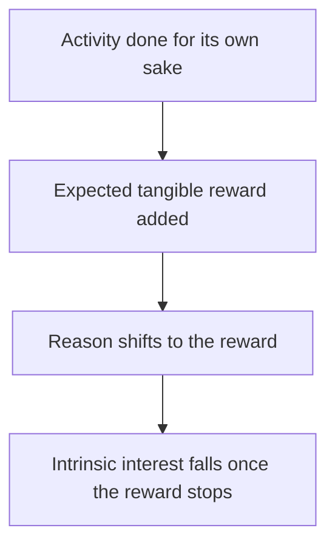

# Motivation and self-determination

## Summary

Motivation is what starts, directs and sustains behavior. Psychologists distinguish intrinsic motivation (doing something for its own sake) from extrinsic motivation (doing it for a reward or to avoid a penalty). Self-determination theory (SDT) says that people are most motivated and well when three basic needs are met: autonomy, competence and relatedness. A meta-analysis shows that tangible rewards can reduce intrinsic motivation, especially when they are expected and controlling.

*This note is educational.*

## Prerequisites

- [Maslow's hierarchy of needs](maslow-hierarchy-of-needs.md).

## Core concepts

### Definition

- **Intrinsic motivation:** interest or enjoyment in the activity itself.
- **Extrinsic motivation:** acting for an outcome separable from the activity, such as money, grades or approval.

Ryan and Deci (2000) describe a continuum in SDT, from amotivation (no intention) through external regulation (rewards and punishments), introjected regulation (guilt and pride), identified regulation (valuing the goal) and integrated regulation to intrinsic motivation. More internalized forms are linked to better persistence and well-being.

### Three basic needs

| Need | Meaning | Support |
| --- | --- | --- |
| Autonomy | Feeling that one chooses and endorses the action | Offer choices and reasons, avoid pressure |
| Competence | Feeling effective and growing | Optimal challenge and clear feedback |
| Relatedness | Feeling connected to and valued by others | Warmth and belonging |

### Rewards and intrinsic motivation

A meta-analysis of 128 experiments by Deci, Koestner and Ryan (1999) found that tangible rewards undermined intrinsic motivation, in particular rewards that were expected and contingent on doing the task, while verbal praise tended to enhance it. The effect is strongest when the reward feels controlling.

### Analogy

Motivation is like the difference between walking because you like the route and walking because a guard is behind you. The pace may be the same, and what happens when the guard leaves is different. The limit of the analogy is that most real motives are mixed.

## Worked example

A manager wants more learning from her team and compares two plans.

| Plan | Design | Predicted effect by SDT |
| --- | --- | --- |
| A | Bonus for each completed course | Short-term completion, risk of lower interest afterwards |
| B | Team chooses topics, has time for learning, shares results and gets feedback | Supports autonomy, competence and relatedness, so higher internal motivation |

Plan B does not exclude pay or deadlines. It places the reward in a context that supports the three needs. The example is an application of the theory and is not a trial.

## Trade offs and when to use it

Extrinsic rewards work well for routine, uninteresting tasks and for starting a behavior, and the risk of harm to intrinsic motivation is greater for interesting tasks. SDT is widely supported and criticized for its claim that the three needs are universal across cultures and for how it treats rewards. Use it as a checklist of conditions.

## Common mistakes

- **Assuming that rewards always raise motivation.** They can reduce it for interesting tasks.
- **Believing that praise is a tangible reward.** Verbal feedback tends to help.
- **Ignoring autonomy.** Control lowers motivation even with good intentions.

## Practice

1. What are the three basic needs in SDT?
2. When do rewards reduce intrinsic motivation?
3. Why might choice improve motivation?

### Answers

1. Autonomy, competence and relatedness.
2. When they are tangible, expected and contingent on the task, and feel controlling.
3. It supports the need for autonomy and the sense of endorsing the action.

## Further reading

- Ryan, R. M. and Deci, E. L. (2000). Self-determination theory and the facilitation of intrinsic motivation, social development, and well-being. *American Psychologist*, 55(1), 68-78. [DOI](https://doi.org/10.1037/0003-066X.55.1.68). Self-determination theory and the facilitation of intrinsic motivation.
- Deci, E. L., Koestner, R. and Ryan, R. M. (1999). A meta-analytic review of experiments examining the effects of extrinsic rewards on intrinsic motivation. *Psychological Bulletin*, 125(6), 627-668. [DOI](https://doi.org/10.1037/0033-2909.125.6.627). A meta-analysis of how extrinsic rewards affect intrinsic motivation.
