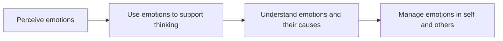

# Emotional intelligence

## Summary

Emotional intelligence (EI) is the ability to perceive, understand, use and manage emotions in oneself and others. The idea was defined by Salovey and Mayer in 1990 as a set of mental abilities and was popularized by Goleman as a broader set of competences. The two views differ, and the evidence is stronger for ability-based EI than for broad claims that EI matters more than IQ. A meta-analysis finds that EI is linked to job performance, with results that depend on how it is measured.

*This note is educational.*

## Prerequisites

- [Multiple intelligences](multiple-intelligences.md) for the wider debate about what counts as an intelligence.

## Core concepts

### Definition

Salovey and Mayer (1990) defined emotional intelligence as the ability to monitor one's own and others' feelings, to discriminate among them and to use the information to guide thinking and action. Their later model has four branches: perceiving emotions, using emotions to facilitate thought, understanding emotions and managing emotions.

### Two kinds of model

| Model | Idea | Measured by |
| --- | --- | --- |
| Ability model | EI is a set of cognitive abilities for processing emotional information | Performance tests with right and wrong answers |
| Mixed model (popular) | EI also includes traits such as optimism, motivation and social skills | Self-report questionnaires |

Mixed models overlap strongly with personality traits, which is a criticism: they may not add much beyond them. The five components often listed in popular books are self-awareness, self-regulation, motivation, empathy and social skills.

### Analogy

Emotional intelligence is like fluency in a second language that everyone partly speaks: some people read the nuance of a tone and respond well, and others miss it. The limit of the analogy is that language has a standard of correctness, and emotions are more often ambiguous.

### Branches

### Evidence

Joseph and Newman (2010) performed a meta-analysis of emotional intelligence and job performance. They found that the relationship depends on the kind of measure, and that its strength is greatest in jobs with high emotional labor. They argue that part of the link in mixed-model measures reflects personality and cognitive ability. The claim that EI is more important than IQ in general is not supported.

## Worked example

A team lead gets a negative reaction after announcing a change. The branches give a sequence of steps.

| Branch | Step |
| --- | --- |
| Perceive | Notice the silence and tense faces |
| Use | Pause and delay the discussion of details until people have voiced concerns |
| Understand | Recognize that the worry is about workload, and not about the idea |
| Manage | Acknowledge the concern, ask for input and set a follow-up |

The example illustrates the ability model and is not a test.

## Trade offs and when to use it

The concept points to skills that can be trained, such as listening and naming emotions, and that matter in roles with a lot of contact with people. Limits: self-report tests are easy to fake, the definitions vary, and popular claims overreach. Use the ability model when precision is needed.

## Common mistakes

- **Equating EI with being nice.** It includes understanding and using emotions, and sometimes firm responses.
- **Claiming that EI matters more than IQ.** The data do not show that.
- **Using self-report scores to select people.** They can be faked.

## Practice

1. How did Salovey and Mayer (1990) define EI?
2. What is the difference between ability and mixed models?
3. What does the meta-analysis of Joseph and Newman (2010) say about measurement?

### Answers

1. The ability to monitor one's own and others' feelings, discriminate among them and use the information to guide thinking and action.
2. Ability models treat EI as cognitive abilities measured by tests, and mixed models add traits and use self-report.
3. The link to job performance depends on how EI is measured, and mixed measures overlap with personality.

## Further reading

- Salovey, P. and Mayer, J. D. (1990). Emotional Intelligence. *Imagination*, Cognition and Personality, 9(3), 185-211. [DOI](https://doi.org/10.2190/DUGG-P24E-52WK-6CDG). The paper that defined emotional intelligence as an ability.
- Joseph, D. L. and Newman, D. A. (2010). Emotional intelligence: An integrative meta-analysis and cascading model. *Journal of Applied Psychology*, 95(1), 54-78. [DOI](https://doi.org/10.1037/a0017286). A meta-analysis of emotional intelligence and job performance.
