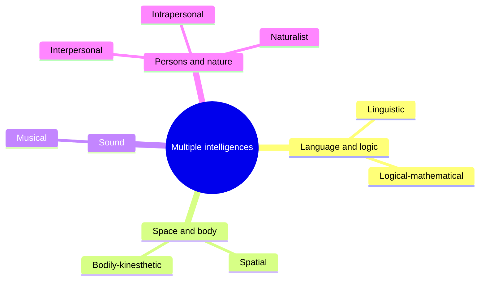

# Multiple intelligences

## Summary

The theory of multiple intelligences, proposed by the psychologist Howard Gardner in 1983, says that human ability is not one general capacity but a set of relatively independent intelligences. Gardner named eight: linguistic, logical-mathematical, spatial, bodily-kinesthetic, musical, interpersonal, intrapersonal and naturalist. The theory is popular in education. Most researchers who study intelligence with tests do not accept it as a scientific theory, because the abilities it describes correlate with each other and with a general factor, and because the independence claim has not been confirmed. It is also not the same thing as learning styles.

*This note is educational. It is not a way to assess or label a person.*

## Prerequisites

No prior notes are needed. The idea of a single general factor of intelligence (*g*) is explained below.

## Core concepts

### Definition

An *intelligence*, in Gardner's sense, is a biopsychological potential to process information in a way that solves problems or creates products that a culture values. The theory makes two claims: there are several such potentials, and they are relatively independent of each other. Gardner did not define intelligence by test scores. He listed eight signs that a candidate ability must show, which he drew from neuroscience, development, evolution and psychology:

1. It can be lost or spared separately after brain damage.
2. It appears in an exceptional form in prodigies, savants or other exceptional people.
3. It has an identifiable core operation or set of operations.
4. It has a distinctive developmental history and a clear expert end state.
5. It has a plausible evolutionary history.
6. Tasks from experimental psychology support it.
7. Psychometric findings support it.
8. It can be encoded in a symbol system, such as language, notation or maps.

### Analogy

Think of a hospital with eight departments, each with its own staff and equipment, against a hospital with one general ward. The theory says the mind looks like the first. The rival view, built on the general factor *g* (Spearman, 1904), says the mind looks more like one shared power supply that all departments draw on. The limit of the analogy is that the departments of a hospital really are separate, and the question in dispute is exactly how separate the mental abilities are.

### The eight intelligences

The mind map shows the eight areas. The table gives the core operation that Gardner associates with each.

| Intelligence | Core operation | Typical activity |
| --- | --- | --- |
| Linguistic | Sensitivity to the meaning, order, sound and rhythm of words | Writing, storytelling, memorizing text |
| Logical-mathematical | Analyzing problems logically, working with number and proof | Equations, programming, scientific reasoning |
| Spatial | Forming and transforming mental pictures | Navigation, design, visual art |
| Bodily-kinesthetic | Using the body or parts of it skillfully | Sport, dance, craft |
| Musical | Sensitivity to rhythm, pitch, melody and timbre | Singing, playing, composing |
| Interpersonal | Reading the moods, motives and intentions of others | Teaching, negotiating, leading |
| Intrapersonal | Understanding one's own feelings, goals and limits | Planning one's life, self-reflection |
| Naturalist | Distinguishing and classifying plants, animals and natural patterns | Field biology, farming, gardening |

The naturalist intelligence was added in the late 1990s. Gardner has discussed further candidates, such as an existential or spiritual intelligence, and has not accepted them because they did not meet his criteria well enough.

### Evidence

The evidence is mixed, and the view of most intelligence researchers is critical. The points that matter:

- **Abilities correlate.** Tests of different cognitive abilities almost always correlate positively. This *positive manifold* is the observation behind *g*. If the intelligences were independent, the correlations would be near zero.
- **A direct test.** Visser, Ashton and Vernon (2006) measured all eight areas with two tests each in 200 people. The tests formed a positive manifold, and a factor analysis found a large general factor. The musical, bodily-kinesthetic and one intrapersonal measure did not correlate significantly with general cognitive ability, which fits Gardner's claim for those areas but also raises the question of whether they are intelligences or talents.
- **A critical review.** Waterhouse (2006) reviewed the evidence and concluded that it does not support the theory as an empirical account of the mind.
- **Education.** The theory has been used to argue for teaching a topic in several ways. That advice can be sound without the theory being right, because varied representations help many learners.

The status, in short: the theory is a debated, mainly educational framework. The existence of strong specific talents is not in doubt. What is disputed is the claim that they are separate intelligences.

### Multiple intelligences are not learning styles

A *learning style* is the claim that a person learns best when instruction matches a preferred mode, such as visual or auditory. A review by Pashler and colleagues (2008) found no adequate evidence that matching instruction to a style improves learning. Gardner's theory is about kinds of ability, not preferences for how to receive information. A person strong in linguistic intelligence does not necessarily learn best by reading. Labeling students by a single intelligence or style can limit what they try.

## Worked example

A teacher plans a lesson on adding fractions and wants to use the theory without labeling pupils.

| Representation | Activity | Area it draws on |
| --- | --- | --- |
| Words | Pupils explain in a sentence why 1/2 + 1/4 is 3/4 | Linguistic |
| Numbers | Pupils find a common denominator and add | Logical-mathematical |
| Pictures | Pupils shade strips of equal length | Spatial |
| Movement | Pupils step along a number line in quarters | Bodily-kinesthetic |
| Rhythm | Pupils clap half and quarter notes | Musical |
| Talk in pairs | Pupils check each other's strips | Interpersonal |

The aim of this plan is to show the same idea in several ways and to let every pupil use several of them. The plan does not sort pupils into groups. This is also the point where the theory and the evidence agree: varied representations are supported by research on learning, while sorting people by type is not.

## Trade offs and when to use it

The theory is useful as a prompt to broaden how a topic is taught and what counts as ability. It is a weak basis for tests, for career advice or for grouping pupils. A strict reading ("this child is bodily-kinesthetic") is a label with little evidence behind it. If a measure of ability is needed, hierarchical models of cognitive abilities with a general factor are the standard in research.

## Common mistakes

- **Treating the theory as proven science.** It is debated, and the tests of independence did not confirm it.
- **Confusing intelligences with learning styles.** They are different claims, and the style claim has the weaker evidence.
- **Using the eight areas as personality types or career matches.** The theory does not supply validated tests for either use.
- **Assuming that a high score in one area means a low score elsewhere.** The correlations between abilities are positive on average.

## Practice

1. Name Gardner's eight intelligences.
2. Why does the positive manifold count against the theory?
3. A school sorts pupils into "visual", "auditory" and "kinesthetic" groups. What does the evidence say?

### Answers

1. Linguistic, logical-mathematical, spatial, bodily-kinesthetic, musical, interpersonal, intrapersonal and naturalist.
2. If the intelligences were independent, scores in different areas would not correlate. Cognitive tests correlate positively, which a general factor explains more simply.
3. Pashler and colleagues (2008) found no adequate evidence that matching teaching to such a style improves learning.

## Further reading

- Gardner, H. (1983). *Frames of Mind: The Theory of Multiple Intelligences*. Basic Books. The book that proposed the theory of multiple intelligences.
- Gardner, H. (1999). *Intelligence Reframed: Multiple Intelligences for the 21st Century*. Basic Books. Adds the naturalist intelligence and discusses candidates such as the existential one.
- Spearman, C. (1904). General intelligence, objectively determined and measured. *The American Journal of Psychology*, 15(2), 201-292. [DOI](https://doi.org/10.2307/1412107). The paper that introduced the general factor g.
- Visser, B. A., Ashton, M. C. and Vernon, P. A. (2006). Beyond g: putting multiple intelligences theory to the test. *Intelligence*, 34(5), 487-502. [DOI](https://doi.org/10.1016/j.intell.2006.02.004). Measured all eight areas in 200 people and found a positive manifold and a general factor.
- Waterhouse, L. (2006). Multiple intelligences, the Mozart effect, and emotional intelligence: a critical review. *Educational Psychologist*, 41(4), 207-225. [DOI](https://doi.org/10.1207/s15326985ep4104_1). A critical review of the evidence for the theory of multiple intelligences.
- Pashler, H., McDaniel, M., Rohrer, D. et al. (2008). Learning styles: concepts and evidence. *Psychological Science in the Public Interest*, 9(3), 105-119. [DOI](https://doi.org/10.1111/j.1539-6053.2009.01038.x). Finds no adequate evidence that matching teaching to a learning style improves learning.
