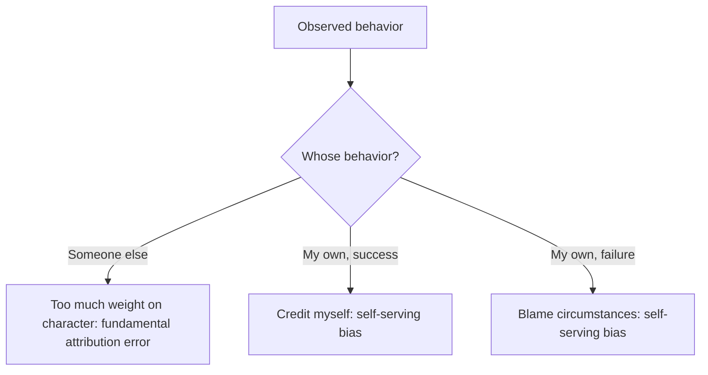

# Attribution biases

## Summary

Attribution is the process of explaining why something happened, usually by pointing to a person (a trait or intention) or to a situation. People make systematic errors in this. The fundamental attribution error is the tendency to explain other people's behavior by their character and to underrate the situation. The self-serving bias is the tendency to credit oneself for success and to blame circumstances for failure. Both are well documented on average, and their size varies by culture and context.

*This note is educational.*

## Prerequisites

- [Heuristics and cognitive biases](../cognitive-psychology/heuristics-and-biases.md).

## Core concepts

### Definition

*Dispositional* attributions explain behavior by a person's traits, and *situational* attributions explain it by circumstances.

- **Fundamental attribution error** (correspondence bias): overweighting dispositions in explaining the behavior of others. In the classic study of Jones and Harris (1967), participants who read an essay praising a political leader inferred a favorable attitude even when they knew that the writer had been assigned the position. Gilbert and Malone (1995) review the bias and its causes.
- **Self-serving bias:** attributing success to internal causes and failure to external ones. A meta-analysis by Campbell and Sedikides (1999) found it, with moderators such as task importance and threat to the self. Mezulis and colleagues (2004) found that it exists across age groups and cultures, with a smaller size in some Asian samples.
- **Actor-observer difference:** the tendency to explain one's own behavior by the situation and the behavior of others by traits.

### Analogy

An observer sees a driver cut in front of a car and concludes "a reckless person". The driver, who is late for the hospital, sees "an emergency". Each has information that the other lacks. The limit of the analogy is that the same person plays both roles on different days.

### Map

## Worked example

A project fails. Three people explain it.

| Person | Explanation | Bias |
| --- | --- | --- |
| Manager about the team | "They were not committed" | Fundamental attribution error |
| Team member about self | "The deadline was unrealistic" | Self-serving bias |
| Colleague about the same project last year | "We succeeded because we are good" | Self-serving bias |

A fairer review lists situational factors (deadline, resources) and personal factors (decisions) for everyone, in the same format, before assigning causes.

## Trade offs and when to use it

Knowing these biases improves feedback, performance reviews and conflict resolution: ask what in the situation led to the behavior, before judging the person. The self-serving bias protects self-esteem and has some benefits for motivation, and it hinders learning from failure. Culture matters: the fundamental attribution error is found in many cultures, though its strength differs.

## Common mistakes

- **Concluding that situations explain everything.** Traits matter too.
- **Assuming the bias is large in every case.** Effects vary with the task and the person.
- **Using the term to dismiss a legitimate judgment of character.** Sometimes the person is the cause.

## Practice

1. State the fundamental attribution error.
2. What does the Jones and Harris (1967) study show?
3. Give an example of the self-serving bias.

### Answers

1. Overweighting character and underweighting the situation when explaining another person's behavior.
2. People inferred the writer's attitude from an essay even when they knew that the position had been assigned.
3. Taking credit for a good exam result and blaming an unfair test for a poor one.

## Further reading

- Jones, E. E. and Harris, V. A. (1967). The attribution of attitudes. *Journal of Experimental Social Psychology*, 3(1), 1-24. [DOI](https://doi.org/10.1016/0022-1031(67)90034-0). The original attitude attribution experiment behind the fundamental attribution error.
- Gilbert, D. T. and Malone, P. S. (1995). The correspondence bias. *Psychological Bulletin*, 117(1), 21-38. [DOI](https://doi.org/10.1037/0033-2909.117.1.21). Reviews the correspondence bias, also called the fundamental attribution error.
- Campbell, W. K. and Sedikides, C. (1999). Self-Threat Magnifies the Self-Serving Bias: A Meta-Analytic Integration. *Review of General Psychology*, 3(1), 23-43. [DOI](https://doi.org/10.1037/1089-2680.3.1.23). A meta-analysis of the self-serving attributional bias.
- Mezulis, A. H., Abramson, L. Y., Hyde, J. S. et al. (2004). Is There a Universal Positivity Bias in Attributions? A Meta-Analytic Review of Individual, Developmental, and Cultural Differences in the Self-Serving Attributional Bias. *Psychological Bulletin*, 130(5), 711-747. [DOI](https://doi.org/10.1037/0033-2909.130.5.711). A meta-analysis of the self-serving bias across age and culture.
