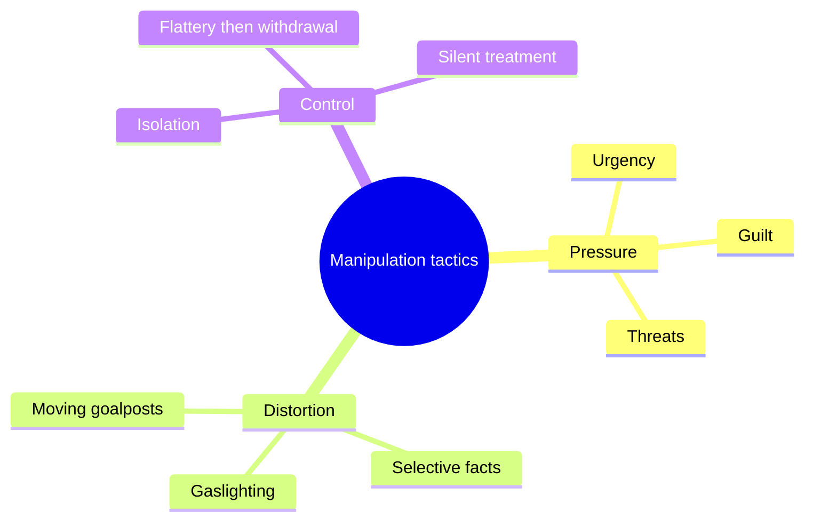

# Dark triad and manipulation

## Summary

The dark triad is a set of three related personality traits: narcissism, Machiavellianism and psychopathy. They share a callous and manipulative style toward others, yet they are distinct traits. Researchers study them as dimensions of normal personality, and the popular term "dark psychology" often refers to manipulation tactics. Knowing the tactics helps with recognizing them. The research does not support the picture of manipulators as master controllers, and it supports the idea that clear boundaries and checking facts are good defenses.

*This note is educational. It is not a way to diagnose a person.*

## Prerequisites

No prior notes are needed.

## Core concepts

### Definition

Paulhus and Williams (2002) showed that three traits overlap and differ:

| Trait | Core | Typical behavior |
| --- | --- | --- |
| Narcissism | Grandiosity, need for admiration | Self-promotion, anger at criticism |
| Machiavellianism | Strategic, cynical manipulation | Planning, deception, use of others |
| Psychopathy | Low empathy, impulsivity, thrill-seeking | Callousness, antisocial acts |

They are measured with self-report scales in samples of the general population, and they are not diagnoses. In clinical settings, psychopathy and narcissistic personality disorder have separate definitions and tools.

### Analogy

The dark triad is like three overlapping circles in a Venn diagram. The overlap is the shared coldness and manipulation, and each circle has its own center. The limit of the analogy is that people sit at points along each trait and do not belong to a circle.

### Common manipulation tactics

These tactics are widely described in the clinical and popular literature. The scientific evidence on how often they work is limited, and many of the sources are practitioner accounts.

## Worked example

A colleague says: "You must decide today or the offer is gone, and everyone else has already agreed." The message contains artificial urgency and a claim of social proof. A defensive reply has four steps: slow down ("I will answer tomorrow"), ask for the facts ("who agreed, and what is the deadline in writing?"), check independently, and decide on one's own criteria. The response does not require diagnosing the colleague, whose motive may be innocent.

## Trade offs and when to use it

Knowing the patterns helps recognize and resist pressure, and avoids self-blame. The dangers: labeling any disagreeable person as a "narcissist" or "psychopath", using the terms as insults, and reading the tactics into ordinary conflict. If a relationship involves fear, threats or control, seek support from a professional or a local service.

## Common mistakes

- **Treating the traits as diagnoses.** They are dimensions of personality.
- **Assuming manipulators are always clever.** Many are not.
- **Confusing persuasion with manipulation.** Persuasion gives reasons and respects the choice, and manipulation bypasses it.

## Practice

1. Name the three traits of the dark triad.
2. Why is the dark triad not a diagnosis?
3. What is a defensive response to artificial urgency?

### Answers

1. Narcissism, Machiavellianism and psychopathy.
2. They are dimensions measured in the general population, and a diagnosis needs a clinical assessment.
3. Slow down, ask for facts in writing, check independently and decide on your own criteria.

## Further reading

- Paulhus, D. L. and Williams, K. M. (2002). The Dark Triad of personality: Narcissism, Machiavellianism, and psychopathy. *Journal of Research in Personality*, 36(6), 556-563. [DOI](https://doi.org/10.1016/S0092-6566(02)00505-6). Shows that narcissism, Machiavellianism and psychopathy are overlapping but distinct traits.
