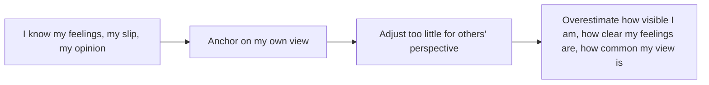

# Egocentric biases in social judgment

## Summary

People take their own perspective as the starting point for judging how others think and what they notice. Three well-studied results follow. The spotlight effect is the belief that others notice one's appearance and slips more than they do. The illusion of transparency is the belief that others can read one's inner feelings. The false consensus effect is the belief that one's own opinions and choices are more common than they are. All three arise because it is hard to adjust away from what one knows.

*This note is educational. It is not mental health advice.*

## Prerequisites

- [Heuristics and cognitive biases](../cognitive-psychology/heuristics-and-biases.md).

## Core concepts

### Definition

- **Spotlight effect.** In the study of Gilovich and colleagues (2000), students wore an embarrassing T-shirt into a room, and estimated that about half of the people there would notice it. Only about a quarter did.
- **Illusion of transparency.** Gilovich, Savitsky and Medvec (1998) found that people overestimate how well others can detect their emotional states, for example nervousness when speaking or the fact that they are lying.
- **False consensus effect.** In the studies of Ross, Greene and House (1977), people who agreed to wear a sign estimated that most others would also agree, and those who refused estimated that most others would refuse.

### Analogy

Each person is the star of their own film and a supporting character in everyone else's. The limit of the analogy is that people do care about being judged, and the result concerns how much attention is actually paid.

### Mechanism

### Practical effects

| Effect | Typical situation | Helpful correction |
| --- | --- | --- |
| Spotlight | Speaking in front of a group, a bad hair day | Others are mostly attending to themselves |
| Transparency | Nervousness before a talk | Tell the audience what you need them to know, since they cannot see it |
| False consensus | Planning a product from one's own preferences | Ask a sample, and do not assume others agree |

## Worked example

A speaker is nervous before a presentation. She believes that the audience will see her shaking hands and her racing heart. The corrections follow the three effects: most of the audience will notice little (spotlight), the nervousness is far less visible than it feels (transparency), and her sense that "everyone finds this topic dull" may reflect her own view (false consensus). She prepares by asking three colleagues what they actually notice during a rehearsal, which replaces her guess by data.

## Trade offs and when to use it

Knowing these biases lowers social anxiety, since observers are less critical than expected, and improves communication, since feelings and views must be stated. Limits: some audiences are attentive, and in close relationships people do read each other better. The research uses mostly student samples.

## Common mistakes

- **Assuming that nobody notices anything.** The finding is about proportion.
- **Assuming that others know what you feel.** State what matters.
- **Treating one's own preferences as the market.** Test with a sample.

## Practice

1. What did Gilovich and colleagues (2000) find?
2. What is the illusion of transparency?
3. Give a business example of the false consensus effect.

### Answers

1. People estimated that about twice as many observers noticed an embarrassing T-shirt as actually did.
2. Overestimating how well others can read one's inner states.
3. A founder who assumes that customers share their preferences and does not test.

## Further reading

- Gilovich, T., Medvec, V. H. and Savitsky, K. (2000). The spotlight effect in social judgment: An egocentric bias in estimates of the salience of one's own actions and appearance. *Journal of Personality and Social Psychology*, 78(2), 211-222. [DOI](https://doi.org/10.1037/0022-3514.78.2.211). The spotlight effect: people overestimate how much others notice them.
- Gilovich, T., Savitsky, K. and Medvec, V. H. (1998). The illusion of transparency: Biased assessments of others' ability to read one's emotional states. *Journal of Personality and Social Psychology*, 75(2), 332-346. [DOI](https://doi.org/10.1037/0022-3514.75.2.332). The illusion of transparency: people overestimate how well others read their feelings.
- Ross, L., Greene, D. and House, P. (1977). The “false consensus effect”: An egocentric bias in social perception and attribution processes. *Journal of Experimental Social Psychology*, 13(3), 279-301. [DOI](https://doi.org/10.1016/0022-1031(77)90049-X). The false consensus experiments.
