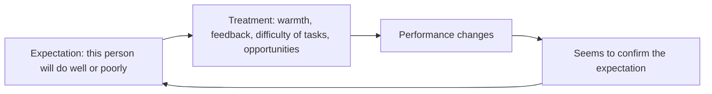

# Expectation effects: Pygmalion, Golem and self-fulfilling prophecies

## Summary

What people expect of others can influence how those others perform. The Pygmalion effect describes better performance when a teacher or manager expects more. The Golem effect is the opposite: lower performance after low expectations. A self-fulfilling prophecy is the general process in which a false belief leads to behavior that makes it come true. The effects exist but are often small, and the original classroom study that made them famous has been criticized.

*This note is educational.*

## Prerequisites

No prior notes are needed.

## Core concepts

### Definition

A *self-fulfilling prophecy* is a belief that causes behavior which makes the belief come true. Rosenthal and Jacobson (1968) reported that pupils whom teachers expected to "bloom" gained more in IQ than other pupils, the Pygmalion effect. The Golem effect is the corresponding negative result. Jussim and Harber (2005) reviewed 35 years of research. They found that self-fulfilling prophecies do occur in classrooms, but are generally small, and that teacher expectations are mostly accurate predictions and not causes.

### Analogy

An expectation is like a lens that changes how a coach looks at an athlete: which questions they ask, how much feedback they give and how much time they spend. The limit of the analogy is that a lens does not change the object, and in the effect the behavior of the coach does.

### Mechanism

## Worked example

Two new employees join a team, and the manager has been told (without basis) that Alex is "high potential" and Sam is "average".

| Manager behavior | Alex | Sam |
| --- | --- | --- |
| Gives stretch tasks | Yes | No |
| Gives detailed feedback | Yes | Brief |
| Meets one-to-one | Weekly | Monthly |
| Result after a year | Develops faster | Slower |

The difference may come from the treatment and not from ability. A manager can test the pattern by keeping a log of tasks and feedback per person and checking that it is balanced. The case is a hypothetical illustration.

## Trade offs and when to use it

The concept is a good reason to set high and fair expectations and to give all people challenging tasks and feedback. It does not mean that belief alone raises performance: effects are small on average, larger for some groups and shrink when expectations are inaccurate and reality gives feedback. The original claims were not reliably replicated at the size first reported.

## Common mistakes

- **Expecting large effects from positive thinking.** The average effects are small.
- **Mistaking accurate prediction for causation.** Teachers' expectations often reflect real differences.
- **Ignoring the Golem effect.** Low expectations can do harm.

## Practice

1. Distinguish the Pygmalion effect and the Golem effect.
2. What did Jussim and Harber (2005) conclude about size?
3. How can a manager check for unequal treatment?

### Answers

1. The first is better performance after high expectations, and the second is worse performance after low expectations.
2. Self-fulfilling prophecies occur, but are generally small.
3. Keep a log of tasks, feedback and meetings per person and compare.

## Further reading

- Rosenthal, R. and Jacobson, L. (1968). *Pygmalion in the Classroom*. Holt, Rinehart and Winston. The original study of teacher expectations, whose effect sizes were later questioned.
- Jussim, L. and Harber, K. D. (2005). Teacher Expectations and Self-Fulfilling Prophecies: Knowns and Unknowns, Resolved and Unresolved Controversies. *Personality and Social Psychology Review*, 9(2), 131-155. [DOI](https://doi.org/10.1207/s15327957pspr0902_3). Reviews 35 years of evidence on teacher expectations and self-fulfilling prophecies.
