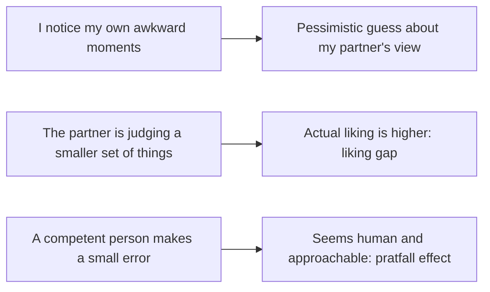

# Liking gap and pratfall effect

## Summary

Two findings about first impressions run against intuition. The liking gap is that people underestimate how much their conversation partners like them. The pratfall effect is that a small blunder can make a highly competent person more likable, though it lowers the rating of a person of average competence. Together they suggest that people are judged more kindly than they fear, and that visible imperfection can help, within limits.

*This note is educational.*

## Prerequisites

- [Egocentric biases in social judgment](egocentric-biases.md).

## Core concepts

### Definition

- **Liking gap.** Boothby and colleagues (2018) had strangers talk, and then asked each how much they liked the other and how much they thought the other liked them. People consistently underestimated their partners' liking, and the gap lasted over time in some samples, including conversations in a laboratory and among students living together.
- **Pratfall effect.** Aronson, Willerman and Floyd (1966) had participants listen to a recording of a quiz contestant. A highly competent contestant who spilled coffee was rated as more attractive than the same contestant who did not. An average contestant who spilled coffee was rated lower.

### Analogy

A first conversation is like a game in which each side keeps score privately: each sees their own awkward moments and only the other's good ones. The limit of the analogy is that each person has no access to the other's scorecard.

### Why they happen

## Worked example

After a networking event, two people leave a conversation of ten minutes. Each thinks "I talked too much and was boring".

| Person | Own rating of how much the other liked them | Other's actual liking |
| --- | --- | --- |
| A | 5 out of 10 | 7 out of 10 |
| B | 4 out of 10 | 7 out of 10 |

The numbers are an illustration of the pattern of Boothby and colleagues (2018), and not data. The practical lesson is to follow up on the conversation: the other person most probably liked it more than expected. A manager who is competent can also admit a small mistake in a meeting without losing standing, which the pratfall effect would support, with the condition that the competence is already clear.

## Trade offs and when to use it

The liking gap lowers the fear of social contact and encourages follow-up. The pratfall effect does not license sloppy work: it applies when the person is already seen as competent, the error is minor and the context is not high-stakes. Later work finds that the pratfall effect depends on gender, self-esteem and the type of error.

## Common mistakes

- **Faking blunders.** The effect needs competence and a natural error.
- **Applying the pratfall effect to serious mistakes.** They lower trust.
- **Assuming that other people judge as harshly as you do.** They usually do not.

## Practice

1. State the liking gap.
2. In the pratfall study, who benefited from the blunder?
3. What action does the liking gap support?

### Answers

1. People underestimate how much a conversation partner likes them.
2. The highly competent contestant, who was rated as more attractive after spilling coffee.
3. Following up and starting conversations, since the other person likes you more than you think.

## Further reading

- Boothby, E. J., Cooney, G., Sandstrom, G. M. et al. (2018). The Liking Gap in Conversations: Do People Like Us More Than We Think?. *Psychological Science*, 29(11), 1742-1756. [DOI](https://doi.org/10.1177/0956797618783714). Shows the liking gap: people underestimate how much conversation partners like them.
- Aronson, E., Willerman, B. and Floyd, J. (1966). The effect of a pratfall on increasing interpersonal attractiveness. *Psychonomic Science*, 4(6), 227-228. [DOI](https://doi.org/10.3758/BF03342263). The pratfall experiment: a blunder raised the liking of a competent person.
