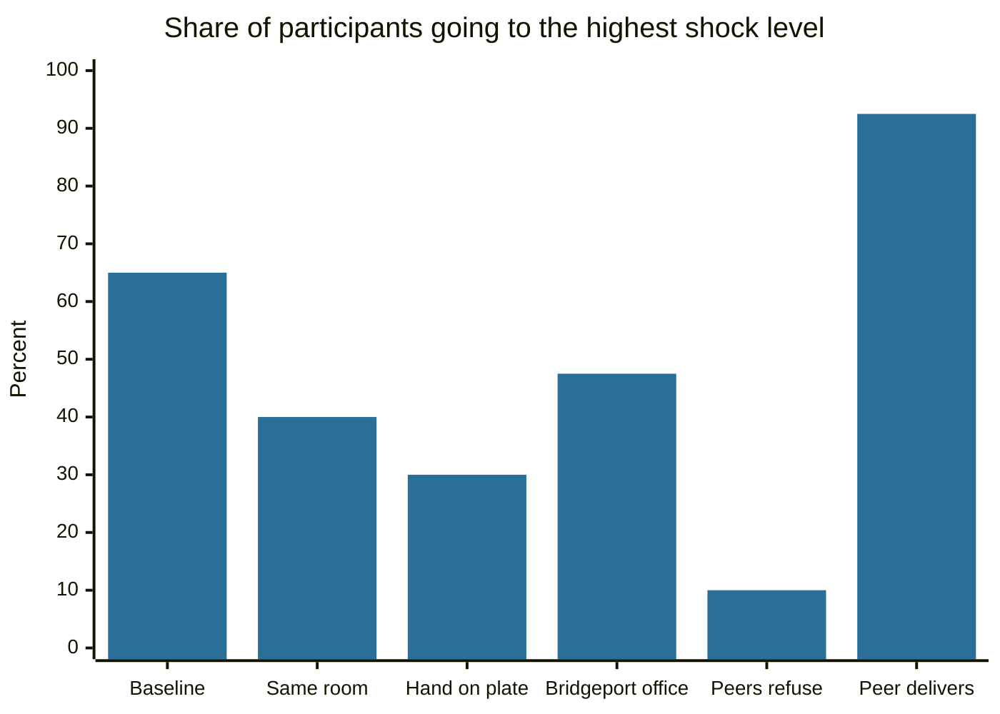

# Milgram obedience experiments

## Summary

In the early 1960s Stanley Milgram asked ordinary adults to give what they believed were increasingly painful electric shocks to another person, on the instruction of an experimenter. In the best-known version, 26 of 40 participants (65%) went to the highest level. The studies are usually read as a demonstration that people obey authority, and they changed research ethics. Later work disputes both the simple reading (participants seem to have followed an appeal to science more than an order) and parts of how the studies were reported.

*This note is educational. The experiments are described to explain a research finding, and the procedure would not be approved today.*

## Prerequisites

No prior notes are needed. [Self-verification theory](self-verification-theory.md) is useful for the idea of commitment and consistency.

## Core concepts

### Definition

The *Milgram experiments* are a series of laboratory studies run at Yale University from 1961 to 1962 and reported in Milgram (1963), (1965) and (1974). They tested how far people would go in harming another person when an authority told them to continue, and how that depends on the situation.

### Procedure

Participants answered a newspaper advertisement for a study of learning and memory. The roles of "teacher" and "learner" were fixed by a rigged draw. The learner was an actor, who was strapped to a chair in another room. The teacher read word pairs, tested the learner and delivered a shock for each wrong answer, 15 volts higher each time, on a generator labeled from 15 to 450 volts. No shocks were actually given. The learner protested, then screamed, and finally went silent. When the participant hesitated, the experimenter answered with a fixed series of prods, from "Please continue" to "You have no other choice, you must go on".

### Analogy

The setup resembles a staircase where each step is only a little higher than the one before. A person who would refuse to jump from the top floor can walk down the stairs one step at a time, because no single step looks like a large decision. The limit of the analogy is that the participants in the studies were not on a staircase of their own choice. They were also told that the study was important and that the experimenter took responsibility.

### Results

- All 40 participants in the first study continued to 300 volts, and 26 (65%) went to 450 volts (Milgram, 1963).
- Many showed obvious distress: sweating, trembling, nervous laughter and protests, but continued.
- Milgram's 1974 book describes 19 variations. Obedience was lower when the learner was closer, when the experimenter was absent or gave orders by telephone, and when two other "teachers" refused. It was very high when another "teacher" carried out the shocks, so that the participant did only a side task.

The chart compares six conditions. The figures are the proportions that went to the highest level. Counts of 26, 16, 12 and 19 are derived from the reported percentages and a group size of 40.



### Explanations

| Explanation | Idea | Status |
| --- | --- | --- |
| Agentic state | Participants see themselves as agents who carry out another person's wishes, which shifts responsibility (Milgram, 1974) | Milgram's own account, widely taught, with limited direct support |
| Gradual escalation | Each step is small, and having done the earlier steps makes it harder to stop | Plausible, linked to commitment and consistency |
| Situation over disposition | Behavior is shaped by the setting more than by character | Broadly accepted for these results |
| Engaged followership | Participants identify with the scientific goal and with the experimenter, and continue because they believe the work is worthwhile | Supported by Haslam and colleagues (2012, 2014) |

Haslam, Reicher and Birney (2014) tested the prods separately in a similar procedure. The prod that was most like an order was the least effective, and the prods that appealed to the scientific goal were more effective. This does not fit a simple account of blind obedience.

### Ethics

Baumrind (1964) criticized the study for the stress it put on participants and for the risk that they learned something harmful about themselves. Milgram answered that most participants later said they were glad to have taken part. The case is one of several that shaped the debate on informed consent, deception and debriefing, which led to the review boards that approve research with people today. Burger (2009) was able to run a partial replication only by stopping at 150 volts and removing participants who might be at risk, and found rates at that point close to Milgram's.

### Criticism

Perry (2012) studied the archives and argued that parts of the published account do not match the records, and that many participants doubted that the shocks were real. These points are disputed. They show that the headline number is a result from one setup, with 40 men, and not a law of human behavior.

## Worked example

Each condition has only 40 people, so every percentage is uncertain. The code computes a 95% Wilson interval for each.

```python
# Python 3.12. Sampling uncertainty of obedience rates with 40 participants per condition.
from math import sqrt

def wilson(k, n, z=1.96):
    """95% Wilson score interval for a proportion k/n."""
    p = k / n
    centre = (p + z * z / (2 * n)) / (1 + z * z / n)
    half = z * sqrt(p * (1 - p) / n + z * z / (4 * n * n)) / (1 + z * z / n)
    return centre - half, centre + half

conditions = {
    "Baseline": 26,
    "Learner in same room": 16,
    "Hand on shock plate": 12,
    "Office in Bridgeport": 19,
    "Two peers refuse": 4,
    "Peer delivers shocks": 37,
}
for name, k in conditions.items():
    lo, hi = wilson(k, 40)
    print(f"{name:22s} {k:2d}/40 = {k/40:5.1%}  95% CI {lo:5.1%} to {hi:5.1%}")
```

Output:

```text
Baseline               26/40 = 65.0%  95% CI 49.5% to 77.9%
Learner in same room   16/40 = 40.0%  95% CI 26.3% to 55.4%
Hand on shock plate    12/40 = 30.0%  95% CI 18.1% to 45.4%
Office in Bridgeport   19/40 = 47.5%  95% CI 32.9% to 62.5%
Two peers refuse        4/40 = 10.0%  95% CI  4.0% to 23.1%
Peer delivers shocks   37/40 = 92.5%  95% CI 80.1% to 97.4%
```

The intervals show what the data can and cannot say. The Bridgeport office (47.5%) overlaps the baseline (65%), which agrees with the report that the drop was not statistically significant. The effect of peers is large: 10% and 92.5% are far apart and far from the baseline. A single baseline figure of 65% could be anywhere from about 50% to 78%.

## Trade offs and when to use it

The studies are a strong teaching case for how situations shape behavior, and for the power of incremental commitment, group pressure and shared goals. They are a poor basis for statements such as "most people would do anything an authority says". The participants were not simply obeying: they also believed in the goal, and the setup had features (a respected institution, a gradual path) that real life does not always have. The studies explain atrocities only in part, since ideology, dehumanization and long-term conditioning are not in the design.

## Common mistakes

- **Reading 65% as a constant.** It is the result of one setup, and other setups gave rates from about 10% to over 90%.
- **Concluding that participants were indifferent.** Most showed distress.
- **Treating responsibility as removed.** Feeling less responsible is a psychological effect and does not remove moral or legal responsibility.
- **Using the agentic state as settled.** It is a hypothesis with limited direct support, and an alternative account fits the data better in several tests.

## Practice

1. What share of participants went to 450 volts in the first study, and what were the counts?
2. Why does the Bridgeport result not prove that the university's prestige does not matter?
3. What is engaged followership?

### Answers

1. 26 of 40 (65%).
2. The drop to 47.5% was not statistically significant, and the intervals overlap, so the data cannot separate the two conditions.
3. The view that participants continued because they identified with the scientific goal and the experimenter, and not because they obeyed orders as such.

## Further reading

- Milgram, S. (1963). Behavioral study of obedience. *The Journal of Abnormal and Social Psychology*, 67(4), 371-378. [DOI](https://doi.org/10.1037/h0040525). The original report: 26 of 40 participants went to the highest shock level.
- Milgram, S. (1965). Some conditions of obedience and disobedience to authority. *Human Relations*, 18(1), 57-76. [DOI](https://doi.org/10.1177/001872676501800105). Reports how distance to the victim and to the experimenter changed obedience.
- Milgram, S. (1974). *Obedience to Authority: An Experimental View*. Harper & Row. Describes the 19 variations of the study and the agentic state account.
- Haslam, S. A. and Reicher, S. D. (2012). Contesting the "nature" of conformity: what Milgram and Zimbardo's studies really show. *PLoS Biology*, 10(11), e1001426. [DOI](https://doi.org/10.1371/journal.pbio.1001426). Argues that participants identified with the study's goals, which fits engaged followership better than blind obedience.
- Haslam, S. A., Reicher, S. D. and Birney, M. E. (2014). Nothing by mere authority: evidence that in an experimental analogue of the Milgram paradigm participants are motivated not by orders but by appeals to science. *Journal of Social Issues*, 70(3), 473-488. [DOI](https://doi.org/10.1111/josi.12072). Finds that appeals to science kept people going and direct orders did not.
- Burger, J. M. (2009). Replicating Milgram: would people still obey today?. *American Psychologist*, 64(1), 1-11. [DOI](https://doi.org/10.1037/a0010932). A partial replication that stopped at 150 volts to meet modern ethics rules.
- Baumrind, D. (1964). Some thoughts on ethics of research: after reading Milgram's "Behavioral study of obedience". *American Psychologist*, 19(6), 421-423. [DOI](https://doi.org/10.1037/h0040128). The best-known contemporary ethical critique of the study.
- Perry, G. (2012). *Behind the Shock Machine: The Untold Story of the Notorious Milgram Psychology Experiments*. The New Press. Archive-based critique of how the studies were run and reported.
