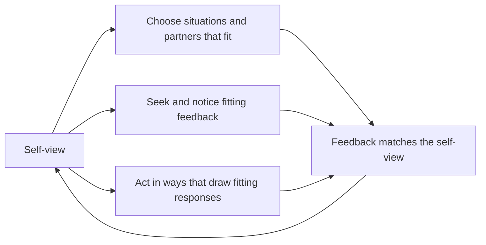

# Self-verification theory

## Summary

Self-verification theory, developed by the social psychologist William Swann from the early 1980s, says that people want others to see them as they see themselves. They look for, create and remember feedback that fits their self-views, because a stable view of oneself makes the social world feel predictable. This holds for negative self-views as well as positive ones, which is the surprising part. The theory does not claim that people dislike praise: it says that the wish for coherence and the wish for favorable feedback both exist and work in different ways.

*This note is educational. It is not psychological advice.*

## Prerequisites

No prior notes are needed.

## Core concepts

### Definition

*Self-verification* is the process by which people try to get others to confirm their existing self-concept. The *self-concept* is the set of beliefs a person holds about their own traits, abilities and roles. The motive behind it is a need for coherence and predictability: if others see me as I see myself, I can anticipate how they will react (Swann, Chang-Schneider and McClarty, 2007).

The theory builds on older ideas. Symbolic interactionism (Mead) holds that the self forms in social interaction. Consistency theories, such as Festinger's cognitive dissonance and Heider's balance theory, hold that people avoid inner contradictions.

### Analogy

A person's self-view works like a map that they use to move through social life. Feedback that matches the map is easy to use. Feedback that does not match forces them to redraw it, which is costly, even when the new map would be more flattering. The limit of the analogy is that a map is tested against terrain, while a self-view is partly kept in place by the person's own behavior.

### Mechanisms

The loop shows the four main routes in the research. The self-view shapes how people choose and read their social world, and the result strengthens the self-view.

| Mechanism | What people do | Example |
| --- | --- | --- |
| Selective interaction | Choose partners and settings that fit their self-view | A person who sees themselves as shy prefers small groups |
| Feedback seeking | Ask for and attend to evaluations that fit | A student who sees themselves as weak at math seeks out critical comments |
| Behavioral confirmation | Act in ways that draw confirming responses | Someone who expects to be disliked acts coldly, and others respond coldly |
| Cognitive filtering | Remember and interpret feedback to fit | Good grades are explained away as luck |

### Evidence

- Swann, Stein-Seroussi and Giesler (1992) studied why people self-verify. In their studies, people with negative self-views tended to choose interaction partners who evaluated them negatively.
- Swann, Hixon and De La Ronde (1992) found that married people with negative self-views were more committed to spouses who saw them negatively.
- Swann, Pelham and Krull (1989) argued that the wish for favorable feedback and the wish for self-confirming feedback can both be present and operate differently.
- Kwang and Swann (2010) combined the relevant studies in a meta-analysis. They found ample evidence of self-enhancement, but little evidence that it overrides self-verification. Both motives were influential and controlled different kinds of responses. When the risk of rejection is high, people seem to give up self-verification and accept favorable views. When the risk is low, as in many secure marriages, people prefer self-verifying views.

### Self-verification and self-enhancement

| Aspect | Self-verification | Self-enhancement |
| --- | --- | --- |
| Goal | Coherence and predictability | A favorable self-view |
| Preferred feedback | Matches the self-view | Positive |
| Applies to | Positive and negative self-views | Most strongly to positive self-views |
| Strongest when | Relationships are close and secure | Rejection is a risk, or the situation is short |

The table simplifies the review by Kwang and Swann (2010). The two motives often act together, and neither is treated as the stronger one.

## Worked example

A new team member, Sam, believes they are "not leadership material". The team lead promotes Sam to coordinator.

| Step | What happens | Mechanism |
| --- | --- | --- |
| 1 | Sam hesitates to take decisions and defers to colleagues | Behavioral confirmation |
| 2 | Colleagues start going to others for decisions | Their response confirms the self-view |
| 3 | A well-received project is described by Sam as "easy" | Cognitive filtering |
| 4 | Sam asks only for feedback on small details | Feedback seeking |

The loop is self-sustaining. A way to interrupt it is to change what the feedback is about: concrete, specific feedback tied to observed behavior is harder to filter out than general praise, and a gradual increase in responsibility lets the self-view change without a sharp conflict. This example is an illustration of the mechanisms and not a report of a study.

## Trade offs and when to use it

Self-verification explains why some people resist praise, why negative self-views persist and why some people stay in relationships that confirm a harmful view. It also has adaptive functions: stable identity and predictable relationships. In practice, it helps to expect resistance when feedback differs strongly from a person's self-view, in therapy, teaching and management. Critics note cultural variation in self-concepts, the difficulty of separating the motive from related ones, and the evidence that self-enhancement dominates in many short interactions.

## Common mistakes

- **Concluding that people want negative feedback.** They want consistent feedback. Favorable feedback can still feel good, and the two motives work in different ways.
- **Concluding that self-verification beats self-esteem needs.** Both motives exist and act on different responses.
- **Assuming the process is deliberate.** Much of it is automatic.
- **Blaming people for their relationships.** The findings are about average tendencies, and the effects are small to moderate.

## Practice

1. What is the motive behind self-verification?
2. What did Kwang and Swann (2010) conclude about self-enhancement and self-verification?
3. Name two mechanisms of self-verification.

### Answers

1. A need for coherence and predictability: others should see the person as the person sees themselves.
2. Both motives are influential and control different kinds of responses. Self-enhancement is not prepotent.
3. Selective interaction and behavioral confirmation (also feedback seeking and cognitive filtering).

## Further reading

- Swann, W. B. and Read, S. J. (1981). Self-verification processes: how we sustain our self-conceptions. *Journal of Experimental Social Psychology*, 17(4), 351-372. [DOI](https://doi.org/10.1016/0022-1031(81)90043-3). Early experiments on how people elicit feedback that fits their self-views.
- Swann, W. B., Pelham, B. W. and Krull, D. S. (1989). Agreeable fancy or disagreeable truth? Reconciling self-enhancement and self-verification. *Journal of Personality and Social Psychology*, 57(5), 782-791. [DOI](https://doi.org/10.1037/0022-3514.57.5.782). Shows that people want both favorable and self-confirming feedback, and that the two motives work differently.
- Swann, W. B., Stein-Seroussi, A. and Giesler, R. B. (1992). Why people self-verify. *Journal of Personality and Social Psychology*, 62(3), 392-401. [DOI](https://doi.org/10.1037/0022-3514.62.3.392). Shows that people with negative self-views seek out partners who see them negatively, and explores why.
- Swann, W. B., Hixon, J. G. and De La Ronde, C. (1992). Embracing the bitter "truth": negative self-concepts and marital commitment. *Psychological Science*, 3(2), 118-121. [DOI](https://doi.org/10.1111/j.1467-9280.1992.tb00010.x). Married people with negative self-views were more committed to spouses who saw them negatively.
- Swann, W. B., Chang-Schneider, C. and McClarty, K. L. (2007). Do people's self-views matter? Self-concept and self-esteem in everyday life. *American Psychologist*, 62(2), 84-94. [DOI](https://doi.org/10.1037/0003-066X.62.2.84). Summarizes how self-views shape behavior and relationships.
- Kwang, T. and Swann, W. B. (2010). Do people embrace praise even when they feel unworthy? A review of critical tests of self-enhancement versus self-verification. *Personality and Social Psychology Review*, 14(3), 263-280. [DOI](https://doi.org/10.1177/1088868310365876). A meta-analysis that finds both motives are influential but control different kinds of responses.
