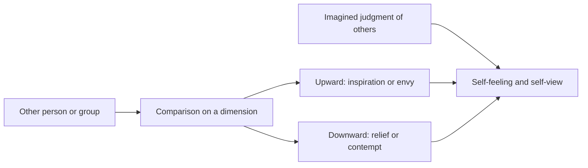

# Social comparison and the looking-glass self

## Summary

People learn who they are partly by comparing themselves with others and by imagining how others see them. Festinger's theory of social comparison (1954) holds that people evaluate their abilities and opinions by comparison with other people when no objective test is available. Cooley's looking-glass self (1902) describes the self as formed by imagining how others judge us. The same mechanisms explain the pressure of comparison on social media and the tall poppy attitude, in which high achievers are resented.

*This note is educational. It is not mental health advice.*

## Prerequisites

- [Self-verification theory](self-verification-theory.md).

## Core concepts

### Definition

- **Social comparison.** Festinger (1954) proposed a drive to evaluate oneself, and a tendency to compare with similar others. *Upward* comparison (with those better off) can motivate or discourage, and *downward* comparison (with those worse off) can raise mood.
- **Looking-glass self.** Cooley (1902) proposed three steps: we imagine how we appear to others, we imagine their judgment, and we feel something like pride or shame. Yeung and Martin (2003) tested the process with survey data and found support for the idea that perceived appraisals by others predict self-views.
- **Tall poppy syndrome.** Feather (1989) studied attitudes toward high achievers: people were less sympathetic to a high achiever's fall when the success was seen as unearned or when the person was not close to them.

### Analogy

Other people are like mirrors in a room of mirrors: each shows a slightly different picture, and none shows the picture without distortion. The limit of the analogy is that a person chooses which mirrors to look into.

### Process

## Worked example

A person scrolls a feed of friends' holiday photos, and compares their own week with the best moments of others.

| Step | What happens |
| --- | --- |
| 1 | Chooses upward comparison with curated highlights |
| 2 | Feels the gap on one dimension, travel |
| 3 | Lowers self-evaluation overall |

A change of the process: compare with oneself over time, choose dimensions that matter, and treat the feed as a sample of highlights. The case illustrates the theory and is not a study.

## Trade offs and when to use it

Comparison is useful for standards and goals, and harmful when the target is unrepresentative or unreachable. The looking-glass self shows why feedback and environment matter for self-view. Evidence on the effect of social media use on well-being is mixed and depends on the type of use.

## Common mistakes

- **Treating all comparison as harmful.** Upward comparison can motivate.
- **Comparing with the highlights of others.** The sample is biased.
- **Assuming that one's imagined image is accurate.** It often differs from others' views.

## Practice

1. When do people compare themselves with others, according to Festinger?
2. What are the steps of the looking-glass self?
3. Name one way to make comparison more useful.

### Answers

1. When no objective standard is available for judging abilities and opinions.
2. Imagine how we appear, imagine the judgment, and feel pride or shame.
3. Compare with oneself over time, or choose relevant and representative targets.

## Further reading

- Festinger, L. (1954). A Theory of Social Comparison Processes. *Human Relations*, 7(2), 117-140. [DOI](https://doi.org/10.1177/001872675400700202). The theory of social comparison processes.
- Cooley, C. H. (1902). *Human Nature and the Social Order*. Scribner. Introduces the looking-glass self.
- Yeung, K. T. and Martin, J. L. (2003). The Looking Glass Self: An Empirical Test and Elaboration. *Social Forces*, 81(3), 843-879. [DOI](https://doi.org/10.1353/sof.2003.0048). Tests the looking-glass self with survey data.
- Feather, N. T. (1989). Attitudes towards the high achiever: The fall of the tall poppy. *Australian Journal of Psychology*, 41(3), 239-267. [DOI](https://doi.org/10.1080/00049538908260088). The study of attitudes to high achievers behind the tall poppy label.
