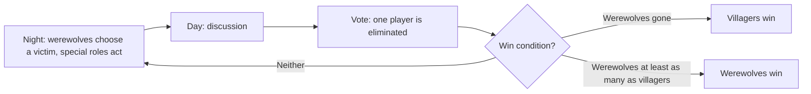
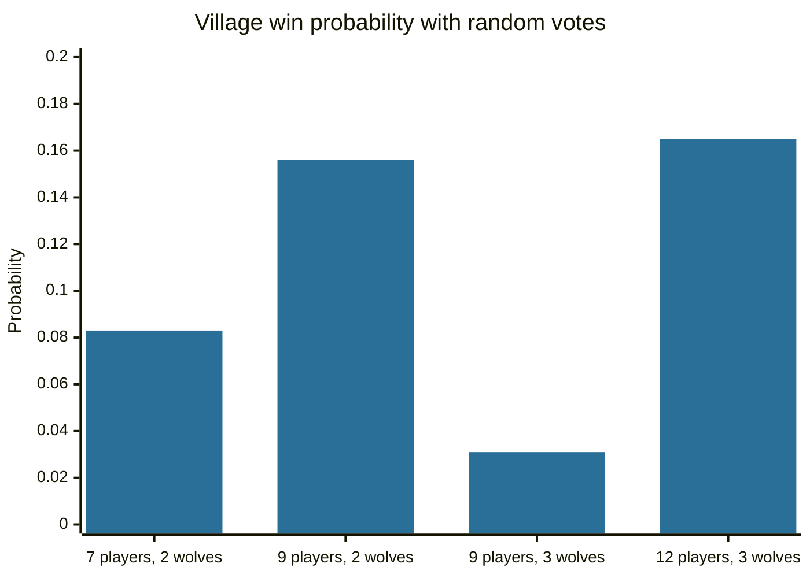

# Social deduction games

## Summary

A social deduction game, such as Werewolf (also called Mafia), gives players hidden roles and asks an informed minority to deceive an uninformed majority while the majority tries to identify them by talking and voting. The format is a small, safe model of deception, trust, persuasion and group decisions. Research on lie detection says that people are poor at spotting deception from behavior alone, so the games reward argument and consistency more than "reading" faces. The game is a teaching case and is not a research instrument on its own.

*This note is educational.*

## Prerequisites

No prior notes are needed.

## Core concepts

### Definition

A *social deduction game* is a game in which some players hold a hidden role with a goal opposed to the others, and the group must decide through discussion whom to trust. In Werewolf, players are secretly assigned to the villagers (the majority) or the werewolves (a minority who know each other). Special villager roles exist, such as a seer who can learn one player's identity each night.

### Structure of the game



The diagram shows the cycle. The villagers win if all werewolves are eliminated, and the werewolves win when they are at least as numerous as the villagers.

### What the game exposes

| Topic | How it appears in the game | Research link |
| --- | --- | --- |
| Deception | Werewolves must act innocent | In a meta-analysis of 206 documents, Bond and DePaulo (2006) found that people judge lies and truths correctly 54% of the time |
| Conformity | Players follow the majority vote even with doubts | Asch (1956) on pressure from a unanimous majority |
| Group decisions | Early consensus can end discussion | Janis (1972) on groupthink |
| Trust under limited information | Players rely on past behavior and consistency | General research on judgment under uncertainty |
| Biases | Confirmation bias, in which players keep the first suspicion; hindsight bias after roles are revealed | General cognitive psychology |

Because accuracy in spotting lies from demeanor is only a little above chance, the more useful signals in the game are content signals: whether a story is consistent, how a player voted earlier, and who benefits from a decision.

### Analogy

The game is a flight simulator for social judgment. It gives a safe place to practice a hard skill with feedback after each round, since roles are revealed at the end. The limit of the analogy is that a simulator is built to match reality, while the game is built to be fun, and its rules (a known number of liars, a fixed end) make it much more structured than real life.

## Worked example

Without any information, how often would the villagers win? The code computes this exactly for a game that starts with a night, with no special roles, in which the villagers vote at random and the werewolves kill a villager each night.

```python
# Python 3.12. Exact village win probability when nobody has any information. The game starts with a night.
from fractions import Fraction
from functools import cache

@cache
def village_wins(v, w):
    """Day phase: v villagers and w werewolves vote out one player at random."""
    if w == 0:
        return Fraction(1)
    if w >= v:
        return Fraction(0)
    p_wolf = Fraction(w, v + w)
    # a wolf is lynched with probability p_wolf, otherwise a villager is
    after_wolf = night(v, w - 1)
    after_villager = night(v - 1, w)
    return p_wolf * after_wolf + (1 - p_wolf) * after_villager

@cache
def night(v, w):
    """Night phase: the werewolves kill one villager."""
    if w == 0:
        return Fraction(1)
    if w >= v:
        return Fraction(0)
    v -= 1
    if w >= v:
        return Fraction(0)
    return village_wins(v, w)

for players, wolves in [(7, 2), (9, 2), (9, 3), (12, 3)]:
    p = night(players - wolves, wolves)
    print(players, wolves, p, round(float(p), 3))
```

Output:

```text
7 2 1/12 0.083
9 2 5/32 0.156
9 3 1/32 0.031
12 3 38/231 0.165
```

With random votes, the villagers win about 8% of games with 7 players and 2 werewolves. This is the baseline against which reasoning is measured. Any higher win rate over many games comes from information: arguments, consistency checks and special roles. The numbers describe a model with no special roles and random votes, and real games differ.



## Trade offs and when to use it

The game suits training in argument, listening and decision-making in groups, and it is used in teaching for that reason. It does not measure lying ability or personality, and results from the game do not transfer to real deception without evidence. Players who are shy or who are eliminated early may have a worse experience, and a facilitator should handle that. The game also shows a negative side effect: accusations in a game can turn into real conflict if the group forgets that the roles are random.

## Common mistakes

- **Treating the game as a lie detector test.** Even in research, demeanor-based judgments are only slightly better than chance.
- **Confusing a convincing performance with truth.** Fluent speech is not evidence of honesty.
- **Locking onto the first suspect.** This is confirmation bias, and it helps the werewolves.
- **Claiming that the game proves facts about real-world behavior.** It is a small model with fixed rules.

## Practice

1. What are the two win conditions in Werewolf?
2. How accurate are people at judging lies from behavior, on average?
3. What does the random-vote baseline tell a player?

### Answers

1. The villagers win when all werewolves are eliminated. The werewolves win when they are at least as numerous as the villagers.
2. About 54% correct (Bond and DePaulo, 2006).
3. How well the villagers would do by chance. Better results must come from information and reasoning.

## Further reading

- Bond, C. F. and DePaulo, B. M. (2006). Accuracy of deception judgments. *Personality and Social Psychology Review*, 10(3), 214-234. [DOI](https://doi.org/10.1207/s15327957pspr1003_2). A meta-analysis of 206 documents: people judge lies and truths correctly 54 percent of the time.
- Asch, S. E. (1956). Studies of independence and conformity: I. A minority of one against a unanimous majority. *Psychological Monographs*, 70(9), 1-70. [DOI](https://doi.org/10.1037/h0093718). The line-judgment conformity experiments.
- Janis, I. L. (1972). *Victims of Groupthink*. Houghton Mifflin. Introduces the groupthink concept from case studies of policy decisions.
