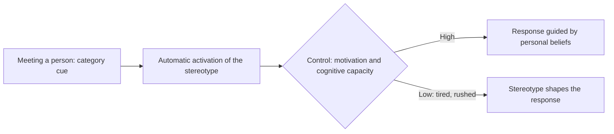

# Stereotypes

## Summary

A stereotype is a set of beliefs about the traits of a group and its members. Stereotypes help people to process social information quickly, and they distort judgment of individuals. Research since Allport (1954) distinguishes the stereotype (belief), prejudice (feeling) and discrimination (behavior). Devine (1989) showed that stereotypes are activated automatically in people of all attitudes, and that low-prejudice people differ in how they control the response.

*This note is educational.*

## Prerequisites

- [Heuristics and cognitive biases](../cognitive-psychology/heuristics-and-biases.md).

## Core concepts

### Definition

*Stereotype* is a belief about a group, *prejudice* an evaluation of a group, and *discrimination* behavior toward its members. Allport (1954) described categorization as a normal process of the mind that simplifies a complex world, and prejudice as a harmful outcome of it. Stereotypes can be descriptive, saying what a group is like, and prescriptive, saying what it should be like.

### Analogy

A stereotype is like a map drawn at a very small scale: it gives a rough sense of the region and lacks the detail needed for any single street. The limit of the analogy is that a map is made to be accurate, while stereotypes also carry evaluations and are shaped by social history.

### Automatic and controlled processes

Devine (1989) argued that knowledge of a cultural stereotype is shared by high- and low-prejudice people, and that the automatic activation of the stereotype is the same for both. The difference lies in controlled processing: low-prejudice people can inhibit the stereotype and replace it with their beliefs, which takes effort and attention.

### Reducing the effect

| Approach | Idea |
| --- | --- |
| Contact | Equal-status, cooperative contact under shared goals reduces prejudice (Allport, 1954) |
| Individuating | Gather specific information about the person |
| Structured decisions | Use clear criteria and blind procedures, for example in hiring |
| Slowing down | Control is weaker under time pressure |

## Worked example

A hiring panel reviews applications. A structured procedure lists criteria in advance, scores each criterion separately before any discussion and removes names from the first screen. The procedure targets the stage at which a stereotype could change the judgment, and it does not rely on the good intentions of the reviewers.

## Trade offs and when to use it

Categorization is necessary and cannot be turned off. The question is how to make judgments of individuals depend on individual information, especially when stakes are high. Stereotypes can contain a statistical kernel and are still poor guides for individuals. The research on interventions shows moderate and short-lived effects of single training sessions.

## Common mistakes

- **Equating stereotype and prejudice.** One is belief, the other is attitude.
- **Believing that only prejudiced people hold stereotypes.** Knowledge of them is shared.
- **Relying on a single training.** Process changes work better.

## Practice

1. Distinguish stereotype, prejudice and discrimination.
2. What did Devine (1989) argue about activation?
3. Name one structural remedy.

### Answers

1. Belief about a group, an evaluation of it, and behavior toward its members.
2. Automatic activation is similar in high- and low-prejudice people, and they differ in controlled processing.
3. A structured evaluation with criteria set in advance.

## Further reading

- Allport, G. W. (1954). *The Nature of Prejudice*. Addison-Wesley. A classic on stereotypes, prejudice and the contact hypothesis.
- Devine, P. G. (1989). Stereotypes and prejudice: Their automatic and controlled components. *Journal of Personality and Social Psychology*, 56(1), 5-18. [DOI](https://doi.org/10.1037/0022-3514.56.1.5). Separates automatic stereotype activation from controlled processing.
